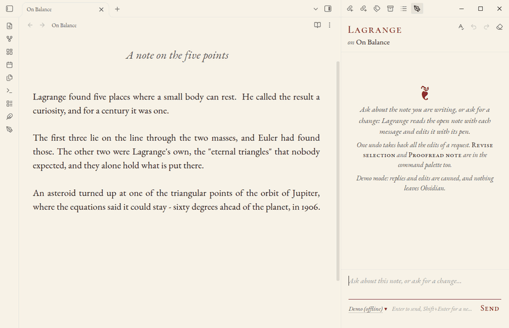

# Scriptorium

A fancy and sophisticated Obsidian configuration for the typographically inclined.



*Lagrange, Scriptorium's writing companion, recorded in Obsidian (Demo provider, so no account is needed to try it).*

Scriptorium gives [Obsidian](https://obsidian.md) book-page typography: bookish serif type, warm paper, centered
small-cap headings, italic subtitles, ornamental drop caps and floral scene breaks, with footnotes set in the margin,
quiet admonitions and a focused view of images, after [gwern.net](https://gwern.net). It is made of:

- **the vault template** (`vault/`): the Typewriter theme, the `manuscript` CSS snippet, writing plugins and a
  Lorem Ipsum sample note;
- **the Scriptorium plugin** (`vault/.obsidian/plugins/scriptorium`), which switches between the regular and the
  Fancy typography, chooses the drop cap, sets footnotes in the margin and images in focus, and (experimental) backs
  the vault up to your own Google Drive and brings it back;
- **Lagrange** (`vault/.obsidian/plugins/lagrange`), a writing companion: a chat about the open note that also edits
  it when you ask (and commands to revise a selection or proofread a note), each edit struck through and written in by
  a pen;
- **Scriptorium Setup** (`installer/`), a small Windows installer that creates a new vault from the template and, if
  you tick them, installs Obsidian, the fonts and the Longform plugin, then opens the vault in Obsidian with its
  plugins on;
- **script installers** for Windows, macOS and Linux (`installers/`).

Screenshots of both modes: <https://williamliaw.com/scriptorium>

## Fancy mode

Fancy mode starts **off**, with centered small-cap section headings and bordered quotations. Turn it on for quiet
italic quotations and justified openings. Both modes open chapters with a drop cap (an ornamental Yinit initial unless
you choose another) and use the same 1.45 line spacing.

In Obsidian, go to **Settings → Scriptorium → Fancy mode**. You can also click the **feather icon**, click
**Fancy mode: on/off** in the status bar, or run **Scriptorium: Toggle fancy mode** from the command palette. Your
choice is remembered for that vault.

## Drop caps, marginalia, admonitions and image focus

These are set in **Settings → Scriptorium**, and remembered for the vault:

- **Drop cap:** the initial that opens a chapter in Reading view: **Yinit** (ornamental, the default), **Goudy
  Initialen** (floriated), a **plain capital** in Cormorant Garamond, or **none**. Each is a three-line drop in the
  accent colour, with the rest of the first line in small capitals; with none, the opening paragraph starts with an
  ordinary letter, without small capitals, justified like the rest.
  **One note can have its own:** run **Scriptorium: Choose the drop cap for this note** and move through the list (the
  note shows each as you go); the choice is kept in the note's properties as `dropcap: goudy` (or `yinit`, `plain`,
  `none`, or the name of a set, below), which you can also type yourself. Choosing **The vault's drop cap** removes
  the property. A drop cap that is chosen or changed is inked in: laid down from its top left corner as a pen would lay
  it, pale and wet at first (not when your system asks for reduced motion).
- **Marginalia** (on by default): in Reading view, footnotes (`[^1]`, and inline `^[...]` notes) are set in the right
  margin beside their references, as on gwern.net: each note hangs from a small box with its number, between dotted
  rules, with a boxed ↙ back to the reference, and notes whose references are close are stacked so that none covers
  another. Hovering a reference lights its note and the other way round. They need a pane wide enough for the text
  column and a note column (with the 22-pixel text, a window about 1,200 pixels wide with the sidebars closed); where the
  right margin alone is too narrow, the text moves left so that text and notes are centred together. In a narrower pane, or with **Readable line length**
  off, footnotes stay at the foot of the note. A callout of type margin (`> [!margin]`) is a marginal note without a
  number. The command **Scriptorium: Toggle marginalia** turns them on and off.
- **Image focus** (on by default): click an image in a note (Reading view or Live Preview) to see it on its own, on a
  dimmed page, fitted to the window, with its caption below. **←** and **→** step through the note's images ("2 of 5"),
  the mouse wheel zooms and dragging pans, double-click zooms in and out, and **Esc**, a click outside the image or the
  × button returns to the note.

### Sets of drop caps: gwern.net's, your own, and drawn ones


Beside the four above, a drop cap can come from a **set**: images, one or several for a letter, or a font of initials.
Sets appear in the settings' **Drop cap** list and in **Choose the drop cap for this note**, and a note names one in its
properties (`dropcap: Dropcat`). A set of images shows where it has the paragraph's first letter; other paragraphs keep
the vault's drop cap. All of this works in Reading view, light and dark, and in **Export to PDF**.

Every kind of initial [gwern.net uses](https://gwern.net/dropcap) is here:

| Drop cap | In Scriptorium | `dropcap:` |
| --- | --- | --- |
| Yinit | built in (a font, A to Z) | `yinit` |
| Goudy Initialen | built in (a font, A to Z) | `goudy` |
| Kanzlei Initialen | included as a set (a font, A to Z) | `kanzlei` |
| Deutsche Zierschrift | included as a set (a font, A to Z) | `de-zs` |
| Dropcat (cats) | a selection included (B C G I Q T); the other 62 images on request | `Dropcat` |
| Gene Wolfe (wolves, suns, swords) | a selection included (F T V); the other 24, or 159, on request | `Gene Wolfe` |
| Ninit (machines and flowers; unfinished at gwern.net) | a selection included (A B C); the other 52 on request | `Ninit` |
| Cheshire Initials | not included: its licence forbids publishing it. Named in the list, with where to download it; add your copy as a set | `Cheshire Initials` |

- **More from gwern.net:** **Scriptorium: Download more drop caps from gwern.net** (also a button in the list) shows
  each image set with its size (Dropcat 2.6 MB; Gene Wolfe 0.9 MB, or 35 MB with the images gwern.net keeps only at
  full size; Ninit 25 MB) and fetches the one you choose from gwern.net into the vault's `Scriptorium/Drop caps`
  folder. Nothing is fetched until you press a button; images already there are skipped, so you can stop and go on
  later; without a connection it says so and changes nothing. A paragraph then has one of its letter's images, the same
  one every time the note is drawn (and in the PDF).
- **Your own:** **Scriptorium: Add a set of drop caps** takes a name and your files: one image for each letter you have
  (SVG or PNG, named for its letter: `A.svg`, `b.png`, `initial-C.svg`; `D-dark.png` for a dark-theme version), or a
  font of initials (`.ttf`, `.otf`, `.woff`, `.woff2`: one file, or one for each letter). Each file is checked (an SVG's
  scripts, links and outside references are taken out; a file that is not what its name says is left out) and the set
  is kept in the vault, in `Scriptorium/Drop caps/<name>/`, where you can also put files yourself. Tick **The images
  are of one colour** and they are drawn in the page's accent colour, in the light and the dark theme: ink on white
  paper is made into ink alone (a `set.json` with `{"mono": true}` says the same for a folder you make by hand; for a
  font, `{"size": 4.2, "margin": "0.1em 0.1em -0.12em 0"}` sets its size and place).
- **Drawn by Lagrange:** **Lagrange: Draw a drop cap (or change one)** asks for a letter, a description ("a woodcut
  initial with oak leaves") and a set, has your provider draw it, keeps it in that set, makes it the note's drop cap and
  inks it in. With **your ChatGPT subscription** it is painted by Codex's image tool (about a minute); with an **OpenAI
  API key** by OpenAI's image model (`gpt-image-2.5-sunburst` unless you name another; OpenAI charges for each image;
  this route is experimental: its requests follow OpenAI's published API and are tested against a stand-in, but have
  not been tried against the live service). Claude has no image model, so with **your Claude subscription**, an
  Anthropic API key or a local server the model writes the initial as a line drawing (SVG), which is plainer; the Demo
  has one drawing of its own. Tick **Change the one this set has** to alter an existing initial ("add a small owl"): a
  painted one goes back to the image model, a line drawing back to the language model, and the earlier one is kept in
  the set's `earlier` folder. Image connectors (Canva's, for one) are not used: through Claude Code, Canva's connector
  hands back only a 200-pixel thumbnail of what it generates.

**Export to PDF** sets the page as Reading view does: the note's title at the top (Scriptorium ticks Obsidian's
**Include file name as title** once; untick it in the export dialogue if you do not want it), the drop caps, a note's
own drop cap included, and the small-capped opening lines.

Callouts (`> [!note]`, `> [!tip]`, `> [!warning]`, `> [!error]` and the others) are set as gwern.net's admonitions, in
the snippet: a tinted slip with a broad band and a printer's mark (☞ for a note, † for danger), darker for the more
urgent kinds, in Reading view and Live Preview, light and dark.

### Marginalia


Write footnotes as usual (`[^1]` in the text and `[^1]: The note.` anywhere below, or an inline `^[note]`), and open
the note in Reading view in a pane wide enough for a margin: each footnote sits beside the line that cites it. Point
at a reference to light up its note; the boxed ↙ in a note goes back to its reference. A callout of type margin
(`> [!margin]`) is a marginal note without a number. **Scriptorium: Toggle marginalia** turns them off and on.

### Image focus


Click any image in a note to see it on its own, fitted to the window, with its caption (`![[image.png|A caption]]`).
The mouse wheel zooms and dragging pans, **←** and **→** go to the note's other images, and **Esc** or a click outside
the image returns to the note.

## Writing conventions

- The filename supplies the title.
- `###### Subtitle` creates a centered italic subtitle.
- `## Chapter heading` creates a centered small-cap chapter heading; `### Section heading` a smaller one.
- `> Quotation` creates an italic quotation.
- `---` creates an ornamental scene break.
- `dropcap: goudy` (or `yinit`, `plain`, `none`, or a set: `kanzlei`, `de-zs`, `Dropcat`, `Gene Wolfe`, `Ninit`, or one
  of your own) in a note's properties gives that note its own drop cap.
- `[^1]` with `[^1]: The note.` creates a footnote, set in the margin in Reading view when there is room.
- `> [!margin]` followed by `> Text` creates an unnumbered marginal note beside the paragraph that follows it.
- `> [!note]`, `> [!tip]`, `> [!warning]`, `> [!danger]` and the other callouts create admonitions.
- `![[image.png|A caption]]` (or ``) gives an image the caption shown when it is in
  focus.
- Images are centred. Put `left`, `right` or `center` before the size to place one: `![[image.png|left|300]]`,
  `![[image.png|right|240]]`, `![[image.png|center]]`. Left and right images float in Reading view.

## Lagrange

Lagrange talks with you about the note you have open and edits it when you ask. Click the **pen-nib icon** (or run
**Lagrange: Open**) for the chat in the right sidebar and type: a question gets an answer, and a request for a change
("fix the grammar", "tighten the second paragraph", "add the equation for kinetic energy") is carried out in the note.
Each edit is struck through and written in by a pen, in handwriting, with a thin trail of ink behind the nib. The
pen writes where the new text stands in the note: its first stroke is where the first letter will be, and its lines
are the note's lines. A long edit is written for three lines (**Settings → Lagrange → Lines the pen writes**) and
the rest is set down at once. An equation is drawn symbol by symbol where the note typesets it, wherever in the edit
it comes, and code (a fenced block, or a code span) is typed on a small typewriter that takes the pen's place. The
edits are then listed in the chat with their reasons.

**Undo and redo.** One **Undo** in the editor takes back all the edits of a request. The two arrows at the head of the
chat do the same for Lagrange's edits only: **Undo** takes back its latest run of edits and **Redo** makes it again,
run by run, and each run in the chat has its own **Undo Lagrange's edits** button. If you have typed in the note
since, your typing is kept and Lagrange says so.

**Rewind.** Each message you send has a small clock at its right (**Rewind to here**). It takes the conversation back
to just before that message, for the model as well, puts the note back as it was when you sent it, and puts the
message back in the box for you to change. If the note has changes of your own since then, Lagrange asks whether to
put the note back or keep it as it is; Undo in the editor brings the later text back either way. Lagrange keeps the
note's text for the last 20 messages; for an older message the clock is grey, and rewinding there leaves the note as
it is. The commands **Lagrange:
Revise selection** and **Lagrange: Proofread note** do the same for a selected passage or for the whole note. To keep
the chat to talk only, turn off **Settings → Lagrange → Edit with the pen from the chat**; the ink trail has a switch
there too, and neither the trail nor the flying pen is shown when your system asks for reduced motion.

Choose who writes the replies in **Settings → Lagrange**. The default is **your Claude subscription**, through Claude
Code (install it, run `claude` once in a terminal and sign in; no API key). The others are Anthropic's Claude with an
API key, your ChatGPT subscription through Codex, OpenAI with an API key, an OpenAI-compatible server such as a local
Ollama, and **Demo (offline)**, which gives canned replies and edits so you can try it without an account. The two
subscriptions work in Obsidian on a computer only; on a phone or tablet Lagrange says so and asks you to choose an API
key provider or the Demo. API keys are kept, as other Obsidian AI plugins keep theirs, in plain text in the vault's
`.obsidian/plugins/lagrange/data.json`.

The **model and the reasoning effort** are at the foot of the chat: click the model's name to choose another model of
the same provider (or type one) and an effort of low, medium or high. Effort is sent only to models that take one
(current Claude models, Claude Code, Codex and OpenAI's reasoning models); for the others the choice is greyed out.

In Obsidian's light theme the panel uses the paper, ink and oxblood of [williamliaw.com](https://williamliaw.com); in
the dark theme it follows the vault's theme.

## Install

See <https://williamliaw.com/scriptorium> for the downloads and instructions.

- **Windows:** download `Scriptorium-Setup.exe` from the
  [latest release](https://github.com/william590y/scriptorium/releases/latest), open it, choose the vault folder and
  click **Install**. It creates a new vault folder (or fills an empty one; a folder that already has files in it is
  never changed by Install: see [Setting up a vault you already have](#setting-up-a-vault-you-already-have))
  and, if you tick them, installs Obsidian, EB Garamond and Cormorant Garamond for the current user, and downloads the
  Longform plugin. No administrator rights are needed. With **Open the vault in Obsidian and turn on its plugins**
  ticked (the default), it then opens the new vault in Obsidian with its community plugins on, so Obsidian does not ask
  whether to trust the vault's author (see [Opening the vault](#opening-the-vault-with-its-plugins-on)). If Obsidian
  is open at that point, Setup asks you to close it and choose **Retry**, or **Cancel** to skip this.
- **Updating (Windows):** open a newer `Scriptorium-Setup.exe` and choose your vault folder (by default
  `Documents\Scriptorium`). When the folder is a Scriptorium vault, the button reads **Update** and the window says which
  version is in it. Update replaces Scriptorium's own files with the new ones: the `manuscript` snippet, the code of the
  Scriptorium, Lagrange, Manuscriptum and Typewriter Mode plugins (and Longform's, if ticked), the Typewriter theme and the vault's
  `README.md`. It keeps everything of yours: your notes, the plugins' settings (`data.json`, such as Fancy mode),
  Obsidian's settings and workspace, and the Lorem Ipsum note; files of the configuration that are missing are added
  back, and nothing is deleted. It turns the `manuscript` snippet and Scriptorium's community plugins back on if they
  were off, leaving your own snippets and plugins as they are. Every file it replaces is first copied to
  `.obsidian\scriptorium-backup-<date>-<time>\`, and if anything fails half-way the vault is put back as it was.
  Restart Obsidian (or reload the vault) afterwards. (An updated vault is one Obsidian already knows, so **Open
  Obsidian when done** only starts Obsidian.)
- **A vault you already have:** see [Setting up a vault you already have](#setting-up-a-vault-you-already-have).
- **Script installers:** `installers/Install-Scriptorium-Windows.cmd`, `Install-Scriptorium-macOS.command` and
  `Install-Scriptorium-Linux.sh` do the same from a terminal; they download the configuration from
  williamliaw.com, pinned by SHA-256. They always open the new vault in Obsidian with its plugins on, as Setup does,
  and say what they did; if Obsidian is open they say so and leave the vault for **Open folder as vault**. On Linux
  this works with the AppImage (which the script installs if it finds no Obsidian) and with an Obsidian on `PATH` that
  has its `obsidian-cli` next to it (the `.deb`); a Snap or Flatpak Obsidian keeps its vault list elsewhere, so the
  script only opens Obsidian's vault switcher. The Linux script needs `python3` and `pgrep` for this.
- **Manual:** extract `Scriptorium.zip` from the latest release, open the folder as a vault in Obsidian, install
  [EB Garamond](https://fonts.google.com/specimen/EB+Garamond) and
  [Cormorant Garamond](https://fonts.google.com/specimen/Cormorant+Garamond), then open **Lorem Ipsum** in Reading
  view. Enable community plugins to use the Fancy mode switch. Longform is enabled in the configuration but not
  included; install it from **Settings → Community plugins**.

### Opening the vault with its plugins on

The first time Obsidian opens a vault that comes with community plugins, it asks whether you trust the vault's author,
and keeps the answer in its own storage, which nothing else should write. Obsidian 1.12 and later has a command line
interface that can give the same answer: `plugins:restrict off` does what the question's
**Trust author and enable plugins** does. The interface works only while `"cli": true` is in Obsidian's `obsidian.json`
(its switch is in **Settings → General → Advanced**), which Obsidian reads when it starts and rewrites while it runs. So
the installers, with Obsidian closed:

1. add the new vault to the vault list in `obsidian.json` (`%APPDATA%\obsidian`, `~/Library/Application
   Support/obsidian` or `~/.config/obsidian`), keeping every other vault and setting, and set `"cli": true`;
2. start Obsidian on the vault;
3. send `vault=<id> plugins:restrict off` until Obsidian answers (it then reloads the vault with the plugins on), and
   wait for the reloaded vault to report `plugins:restrict` = `off`;
4. turn the command line interface off again through Obsidian itself (its own setting switch), unless it was on
   before.

They talk to Obsidian the way its own client does: Setup and the Windows script through the pipe
`\\.\pipe\obsidian-cli-<user>`, the macOS and Linux scripts with the `obsidian-cli` that comes with Obsidian. If
anything fails, the vault is open and Obsidian asks its usual question; the interface is still turned off, through
Obsidian, or in `obsidian.json` once Obsidian has closed (if Obsidian stops answering, a small background process
waits for it to close). An Obsidian older than 1.12 has no command line interface: the vault is opened and Obsidian
asks. To review the plugins later, or to turn them off, use **Settings → Community plugins → Restricted mode**.

## Setting up a vault you already have

Any vault can be made a Scriptorium vault in one step: a vault you already write in, a new vault Obsidian has just
made, or a folder of notes that has never been opened in Obsidian. There are three ways, and they follow the same
rules:

- **In Obsidian:** in a Scriptorium vault, run **Scriptorium: Set up another vault** from the command palette, choose
  the other vault's folder, read what will change, and click **Set up**. It copies Scriptorium from the vault you are
  in (never your Lagrange API keys or any other setting of yours). **Scriptorium: Set up this vault** does the same to
  the vault you are in, which turns Scriptorium's theme, snippet and plugins back on if they were turned off. Obsidian
  on a computer only.
- **Windows:** open `Scriptorium-Setup.exe` and choose the vault's folder. For a folder that has files in it and is not
  a Scriptorium vault yet, the button reads **Set up**; it asks first, saying how many files it will add and merge.
  (`Scriptorium-Setup.exe --setup-plan <folder>` prints the whole list and changes nothing; `--setup-only <folder>`
  sets it up without a window.)
- **Any system:** `python3 installers/Setup-Scriptorium-Vault.py /path/to/vault` (Python 3.8 or later, nothing else).
  It lists what it will change and asks before doing it; `--dry-run` only lists, `--yes` does not ask. From a checkout
  it takes Scriptorium from `vault/`; alone, it downloads `Scriptorium.zip` from williamliaw.com, pinned by SHA-256.

What setting up does, and does not do:

- It writes only inside the vault's `.obsidian` folder. **No note is touched**, nothing is deleted, and the sample
  note and README of the Scriptorium vault are not brought along.
- Scriptorium's own files are added: the `manuscript` snippet, the Typewriter theme, and the Scriptorium (with its
  sets of drop caps), Lagrange, Manuscriptum and Typewriter Mode plugins. A file of the same name that differs is replaced.
- Your settings are merged, not overwritten. Your community plugins stay on and Scriptorium's are added to the list;
  your snippets stay on and `manuscript` is added; the theme becomes Typewriter; Scriptorium's text size (22) is set
  only if you have not chosen one. A plugin's own settings (`data.json`) are written only if it has none. Your hotkeys,
  workspace, core plugins and every other setting are left as they are.
- Before anything changes, the whole `.obsidian` folder as it was is copied to
  `.obsidian/scriptorium-backup-<date>-<time>/.obsidian`. If anything fails half-way, every file is put back. To undo
  a setup later, copy the files back from that folder.
- Run again, it changes nothing and makes no second backup.

Close the vault in Obsidian first (Obsidian rewrites some of these files while a vault is open), or reload it
afterwards. When you open it, Obsidian asks whether to trust the author of its plugins: choose **Trust author and
enable plugins**. Install the fonts as in **Manual** above if this computer does not have them (Scriptorium Setup
offers to).

## Backing up a vault to Google Drive (experimental)

Scriptorium can keep a copy of a vault in your own Google Drive and bring it back on any computer: a free stand-in for
a sync service, run only when you ask. It needs no server of ours. There are two ways for it to reach your Drive, and
you choose one in **Settings → Scriptorium → Connection**:

- **Through Claude Code** (the default). The work is done by [Claude Code](https://claude.com/code) on your computer,
  signed in to your Claude account (Pro or Max), through that account's Google Drive connector. No Google sign-in of
  your own is needed. Tested on Linux with Claude Code 2.1 and synthetic vaults.
- **Google sign-in, directly** (a preview, new in 1.2.2). You sign in to Google in your browser, once, and Scriptorium
  talks to Google Drive itself: no Claude account, no model in between, files of any size, changed files updated in
  place, and pictures that Drive can show. **It has not yet been checked against the real Google Drive**: its author
  had no Google client ID to test with, so it has only been run against a pretend Google that follows Google's
  documentation (sign-in, uploads, downloads, errors). That is why it is not the default yet. See
  **Signing in to Google directly** below.

Both are **experimental**, and Google or Anthropic may change what they stand on. Keep another backup of anything you
cannot lose.

The commands, in the command palette (and buttons in **Settings → Scriptorium**). Obsidian on a computer only; on a
phone or tablet they say so.

- **Scriptorium: Back up this vault to Google Drive.** Shows what it will do, then sends new and changed files to the
  Drive folder `Scriptorium/<vault name>/`, in the vault's own folders. Only what changed since the last backup is
  sent. A file you deleted is moved to `_trash/<date>/` inside that Drive folder: nothing is deleted for good. If
  another device has backed up since, its changes are brought in first.
- **Scriptorium: Sync now with Google Drive.** The same work under the name you would look for on a second computer:
  bring in what changed in Drive, then send what changed here.
- **Scriptorium: Retrieve a vault from Google Drive.** Lists the vaults in the Drive folder (name, number of files,
  size, when and from which device it was last backed up), asks for a new or empty folder, downloads the vault into
  it, checks every file against the SHA-256 recorded at backup, sets Scriptorium up in it (the same code as **Set up
  another vault**), and offers to open it.
- **Scriptorium: Connect to Google Drive with a Google sign-in (preview).** Signs in and stops.
- **Scriptorium: Copy the Google Drive diagnostic report.** See **When it does not work**.

To get a vault back on a new computer:

1. Install Scriptorium (see **Install**) and open the vault it makes.
2. Make the same connection as on the computer that backed it up. Through Claude Code: install Claude Code, run
   `claude` once in a terminal and sign in with the Claude account whose Google Drive connector is on (claude.ai →
   **Settings → Connectors → Google Drive → Connect**). With a Google sign-in: choose it in **Settings → Scriptorium →
   Connection**, paste the same client ID and secret, and click **Connect…**.
3. Run **Scriptorium: Retrieve a vault from Google Drive**, choose the vault and a folder, and click **Open the
   vault** when it is done.

**A backup belongs to the way that made it.** A Google sign-in is only allowed to see the files it stored itself (see
below), so it cannot see a vault that was backed up through Claude Code, which is every backup made with Scriptorium
1.2.0. Retrieve such a vault through Claude Code; or, on the computer that has the vault, switch the connection to the
Google sign-in and back up again. That makes a second, complete backup: Google Drive then shows two folders named
`Scriptorium`, and you may delete the older one there once the new one is done. In the other direction, a backup made
with the Google sign-in is listed through Claude Code but is not written or retrieved that way, so that the two never
mix in one folder.

**Two devices.** Each device remembers what it last saw of the backup. A file changed on one side goes to the other.
A file changed on both sides keeps both: the version from Drive takes the file's name and yours is renamed
`name (conflict <device> <date>).md`, and backed up too; compare them and delete the one you do not want. A change
always wins over a deletion. A file deleted on another device is moved to this vault's `.trash` folder, not removed.
Nothing syncs by itself in this version, and two devices should not sync at the same moment (there is no lock; the
later one to finish writes the list of files).

**What is backed up.** Your notes and attachments, and the settings that make the vault yours: Obsidian's settings
files in `.obsidian` (not the workspace), your own CSS snippets and themes, and the settings of the Scriptorium,
Manuscriptum, Typewriter Mode and Longform plugins. **Not** backed up: Lagrange's settings (they hold API keys), the
Google sign-in (it is not in the vault at all), other plugins' code and settings, Scriptorium's own code, snippet and
theme (setting up a vault puts those back), the workspace, caches, `.trash`, hidden folders, and
`.obsidian/scriptorium-backup-…`. The dialog lists every file it leaves out.

**Windows, macOS and Linux.** A vault backed up on one can be retrieved on another. Two things cannot cross: a file
whose name Windows refuses (one of `< > : " | ? *`, a name ending in a full stop or a space, or a reserved name such as
`aux`), and two files whose names differ only in capital letters on a disk that holds them to be one (Windows and
macOS, as a rule). Such a file is listed with the reason and left in the backup; everything else is retrieved. Rename
it on the computer it came from, back up there, and retrieve again.

### Signing in to Google directly (preview)

Choose **Google sign-in, directly** in **Settings → Scriptorium → Connection**, then **Connect…** (or run any of the
backup commands: they lead you there).

1. If Scriptorium has no Google client ID yet, the window explains how to make one and asks for it (next section).
2. **Connect to Google Drive** opens Google's sign-in page in your browser. Choose the account to back up to and allow
   Scriptorium to "see, edit, create and delete only the specific Google Drive files you use with this app".
3. The browser says "Connected to Google Drive"; Obsidian carries on by itself.

What happens underneath: the sign-in is Google's
[OAuth 2.0 for installed apps](https://developers.google.com/identity/protocols/oauth2/native-app) with PKCE. While
you are in the browser, Scriptorium listens on `http://127.0.0.1:<a free port>` on your own computer, and Google's
page sends the browser back there with a one-time code. Scriptorium asks for one permission only,
`https://www.googleapis.com/auth/drive.file`, which Google lists among its
[non-sensitive Drive scopes](https://developers.google.com/workspace/drive/api/guides/api-specific-auth): it can
create files and change the files it created, and cannot see anything else in your Drive.

The sign-in (a refresh token) is kept in one file for your user account on that computer, **outside every vault**, so
it is never backed up, never synced by a sync service that syncs your vault, and never copied by **Set up another
vault**: `%APPDATA%\Scriptorium\scriptorium-google-drive.json` on Windows,
`~/Library/Application Support/Scriptorium/` on macOS, `~/.config/scriptorium/` on Linux. Only your user may read the
file, and where Obsidian offers the system keychain (Electron's safeStorage) the token in it is encrypted with it.
**Disconnect**, in the settings, revokes the token at Google and deletes it. You can also withdraw it from Google's
side at [myaccount.google.com/connections](https://myaccount.google.com/connections).

Files then go over Google's [Drive API](https://developers.google.com/workspace/drive/api/guides/manage-uploads):
small ones in one request, large ones in resumable sessions of 8 MB parts that carry on after an interruption, even in
a later run (Google keeps a session for a week). There is no size limit of Scriptorium's own. A changed file is
written into the same Drive file (Drive keeps its earlier versions for a while). Downloads are resumed with `Range`
where they broke off and hashed as they arrive. Answers 429, 5xx and rate-limit 403 are tried again with a doubling
wait, as [Google asks](https://developers.google.com/workspace/drive/api/guides/handle-errors). An empty file is
recorded in the backup's list only. The requests go straight to Google: an HTTP proxy set in the system is not used.

**Phones and tablets: not supported.** The sign-in needs a program that can listen on `127.0.0.1` for Google's answer
and read and write files outside the vault, which Obsidian on a phone or tablet cannot. Google's older alternative,
copying a code by hand, [is no longer supported](https://developers.google.com/identity/protocols/oauth2/resources/oob-migration).
(Google's [flow for devices without a browser](https://developers.google.com/identity/protocols/oauth2/limited-input-device)
does allow `drive.file`, but needs a client of another type and is not implemented.)

### A Google sign-in of your own: making a client ID

Google asks every program that signs people in for an "OAuth client ID", which belongs to a Google Cloud project.
This release of Scriptorium has none built in, so each writer makes one, once. It is free, needs no payment method,
and takes about five minutes. The Google account you do this with need not be the one you back up to.

1. **Make a project.** Open [console.cloud.google.com/projectcreate](https://console.cloud.google.com/projectcreate),
   name it (say "Scriptorium backup") and click **Create**. Make sure it is the project chosen at the top of the page
   for the next steps.
2. **Turn on the Drive API.** Menu → **APIs & Services → Library** → search for **Google Drive API** → **Enable**.
3. **Describe the app.** Menu → **Google Auth Platform** → **Get started**. App name: Scriptorium. Support email:
   yours. Audience: **External**. Contact: your email. Agree, then **Create**.
4. **Name the permission.** **Data Access → Add or remove scopes** → tick the one ending in `/auth/drive.file` →
   **Update** → **Save**.
5. **Publish it.** **Audience → Publish app → Confirm**. (Or leave it in "Testing" and add your Google account under
   **Test users**; then the sign-in lasts seven days at a time. See below.)
6. **Make the client.** **Clients → Create client** → Application type: **Desktop app** → **Create**. Copy the
   **client ID** and the **client secret** at once (Google shows the secret only then), or download the JSON.
7. **Give them to Scriptorium.** Paste them into the window, or into **Settings → Scriptorium → Google OAuth client
   ID** and **client secret**. The ID box also takes the whole JSON file. Then **Connect…**.

Keep the client ID and secret (a password manager will do). **To retrieve a vault on another computer you sign in
with the same client ID**: Google shows a sign-in only the files that were stored under its own client ID's project,
so a new client ID in a new project sees an empty Drive. Google does not treat a desktop program's client secret as a
secret ("the client secret is obviously not treated as a secret",
[Using OAuth 2.0 to Access Google APIs](https://developers.google.com/identity/protocols/oauth2)), which is why PKCE is
used as well; all the same it is yours, and nobody else needs it.

For the repository's owner: a client ID shared by everyone who uses Scriptorium goes in one place,
`DRIVE_DEFAULT_CLIENT` in `vault/.obsidian/plugins/scriptorium/main.js`. While it is empty, the windows ask each
writer for their own, as above. Once it is filled in, writers need no setup at all, and all of them count as users of
that one Google Cloud project, with the consequences below.

**What Google imposes** (checked against Google's pages on 12 November 2026; they change, and none of this has been
observed by us with a real sign-in):

- **An app left in "Testing"** lets only the accounts listed as test users sign in, at most 100 of them, shows them a
  warning first, and signs them out after seven days: "Authorizations by a test user will expire seven days from the
  time of consent", refresh token included. The exception for apps that ask only for name, email and profile does not
  cover `drive.file`. ([Manage App Audience](https://support.google.com/cloud/answer/15549945))
- **An app "In production"** that asks only for a non-sensitive scope such as `drive.file` does not have to pass
  Google's verification: "If your app utilizes only non-sensitive scopes, it is not mandatory for your app to complete
  the app verification process"
  ([When is verification not needed](https://support.google.com/cloud/answer/13463073)). Its sign-ins do not expire
  after seven days.
- **The "Google hasn't verified this app" screen and the cap of 100 users** are, by Google's description, for apps
  that request sensitive or restricted scopes before they are verified: "Google will display an Unverified apps
  warning message if your project's OAuth clients request authorization of scopes considered sensitive or restricted";
  "The user cap limits the number of users that can grant permission to your app when requesting unapproved sensitive
  or restricted scopes" ([Manage App Audience](https://support.google.com/cloud/answer/15549945),
  [Unverified apps](https://support.google.com/cloud/answer/7454865)). By that description an app in production that
  asks only for `drive.file` should show neither. Google's pages are not of one mind, though: one says that "all
  production apps" must complete verification ([Get started](https://support.google.com/cloud/answer/15544987)), and
  the warning also appears whenever the scopes an app requests differ from the ones entered under Data Access (step
  4). If you see the warning with a client ID of your own, choose **Advanced**, then **Go to Scriptorium**: you are
  the app's maker.
- **The app's name and logo** on Google's consent page need "brand verification", a lighter check: "Without
  verification, only your application domain will be visible to users"
  ([Manage App Branding](https://support.google.com/cloud/answer/15549049)). It matters for a client ID shared by many
  people, not for one of your own.
- **A sign-in stops working** if you withdraw it, if it is not used for six months, or if the same account signs in
  with the same client ID more than 100 times (the oldest is dropped)
  ([Using OAuth 2.0](https://developers.google.com/identity/protocols/oauth2)). Scriptorium then says so and asks you
  to connect again; the backup is untouched.
- **The loopback address** `http://127.0.0.1:<port>` remains supported for clients of type "Desktop app"
  ([Loopback IP address flow migration](https://developers.google.com/identity/protocols/oauth2/resources/loopback-migration)).
  A client of type "Web application" does not allow it: Google answers `redirect_uri_mismatch`.

### When it does not work

Every failure is meant to say what it is and what to do: Claude Code not found (and where it was looked for), not
signed in, signed in with an API key, no Google Drive connector, a Claude Code that does not answer within 90 seconds,
a client ID that Google does not know, an account that is not a test user, the Drive API not turned on, a full Drive,
no network, a folder that cannot be written to or has no room, and, when **Retrieve** finds no vault, the likely
reasons: backed up the other way, to another Google account, under another client ID, or to a folder of another name.

If the message does not help, click **Copy diagnostic report** (in the window, in **Settings → Scriptorium**, or as a
command) and paste it into an issue. The report says which version, system and connection, each step and how it
ended, and how many requests got which answer. It has no text of any note, no name of any file, folder or vault, and
no password, token or key; an email address is cut down to its first letter and its domain, and paths in your home
folder start at `~`.

### Through Claude Code: limits, what the model sees, and what it costs

**Limits.**

- A file over 7 MB is skipped and listed (the connector accepts about 7.4 MB per file). An empty file is recorded in
  the backup's list only, since Drive takes no empty upload.
- The connector cannot replace a file's content, so a changed file is uploaded again and the old copy goes to Google
  Drive's trash.
- Speed, measured on a synthetic vault of 34 files (8.7 MB: 24 notes, a PDF, images and a 6.9 MB recording): first
  backup 1 min 32 s, a later backup of eight changes 1 min 15 s, retrieving it all 45 s, and checking that nothing
  changed 14 s. A vault of 500 notes should take roughly 5 to 8 minutes the first time (an estimate from those rates,
  about 30 files every 15 s) and about a minute for a day's changes afterwards.
- Images are stored in Drive under a neutral file type, so Drive's web page may not preview them; downloaded, by
  Scriptorium or by hand, they are the same files. (Under an image type, Claude Code would hand a downloaded picture
  to the model instead of saving its bytes.)
- Stopping is safe: what was done is recorded after every batch, and running the command again carries on. A run
  stopped at the wrong moment can leave a stray duplicate in the Drive folder; it is harmless.
- The backup is as private as your Drive and your Claude account. It is not encrypted by Scriptorium.

**What the model sees, and what it costs.** Scriptorium gives Claude Code a numbered list of exact Drive calls, about
ten files to a run, three runs at a time. The model (Haiku, the smallest, unless you change it in the settings) is
given the **names** of your files and folders (with the vault's path on your computer) and their Drive ids, and makes
the calls. It is **not given what is in
your files**: an upload names the file and its SHA-256 and Claude Code reads and sends the bytes itself; every result,
downloads included, is saved by Claude Code to a file that only Scriptorium reads and then deletes; and every tool but
the Google Drive ones is refused, so the model cannot open a file. File names and tool calls do pass through
Anthropic, as in any use of Claude Code. Nothing the model says is trusted: Scriptorium reads each call and result
itself and checks ids, sizes and hashes. Each run uses a little of your subscription's usage (a first backup of
34 files was 13 runs, about $0.07 at API prices; 500 notes would be some 60 runs; nothing is billed on a subscription).

**Other storage.** Box: not yet supported (untested; its connector cannot be inspected without signing in to Box).
A ChatGPT account through Codex: not supported; the Codex command line showed no Google Drive or Box tools to a
non-interactive run when this was written.

## Building

Everything is built from this repository; the release files are built by GitHub Actions
(`.github/workflows/build.yml`) on GitHub-hosted runners.

| Output | Command | Needs |
|---|---|---|
| `dist/Scriptorium.zip` | `python3 tools/build_zip.py` | Python 3.9 or later |
| `dist/Scriptorium-Setup.exe` | `tools/build_exe.sh` (rebuilds the zip first) | [Mono](https://www.mono-project.com) (`csc` on `PATH`, or `MONO=<prefix>`) |
| `installer/fonts/*.ttf` (committed) | `python3 tools/build_fonts.py` | Python 3.9 or later, [fontTools](https://github.com/fonttools/fonttools) |
| Lagrange's unit tests | `node --test plugins-tests/lagrange.test.js` | Node.js 18 or later |
| Setting up a vault you already have | `python3 tools/test_setup_vault.py [dist/Scriptorium-Setup.exe]` | Python 3.9 or later; Node.js for the plugin's command; Mono for the exe off Windows |

The Scriptorium plugin's layout and parsing helpers (sidenote placement and stacking, footnote definitions, image
captions) are tested with `node --test plugins-tests/scriptorium.test.js` (Node 18 or later); CI runs it on Linux.

The zip is deterministic: sorted entries, one fixed timestamp (or `SOURCE_DATE_EPOCH`) and fixed permissions, so the
same `vault/` gives the same bytes. CI rebuilds it on Linux and checks that it matches the Windows build. The installer
embeds the zip as the resource `Scriptorium.zip`. On Windows, CI compiles it with the Roslyn `csc.exe` from Visual
Studio Build Tools against the .NET Framework 4.8 reference assemblies, with the same switches as `build_exe.sh`.

The installer draws its own window in Scriptorium's style, ink on paper, set in EB Garamond and Cormorant Garamond. It
embeds the four faces it uses (`installer/fonts/`): static instances of the same pinned Google Fonts files it downloads,
subset to Latin and given private names, made by `tools/build_fonts.py`. They only draw the window; they are never
installed.

To check a build without installing anything:

```sh
mono dist/Scriptorium-Setup.exe --extract-only /tmp/scriptorium-check/vault   # on Windows, run the exe directly
```

This unpacks the embedded vault into a new (or empty) folder and exits; it downloads nothing. Likewise,
`Scriptorium-Setup.exe --update-only <vault>` updates an existing Scriptorium vault in place, as **Update** does, but
without Longform and without downloading anything. `python3 tools/test_update.py dist/Scriptorium-Setup.exe` tests it
(edited notes, settings and snippets kept, Scriptorium's files replaced and backed up, settings merged, unreadable JSON
left alone, other folders refused, a failure half-way undone); CI runs it on Windows, and it runs under Mono elsewhere
(`MONO=<prefix>`).

`Scriptorium-Setup.exe --register-only <obsidian.json> <vault> [--cli]` adds a vault to the vault list in the given
`obsidian.json`, as opening the vault does. `python3 tools/test_auto_open.py dist/Scriptorium-Setup.exe` runs the same
cases (no file yet, other vaults and settings kept, a vault already listed, `"cli"` on, off or missing and put back,
unreadable files left alone) against Setup and against each script's own editor of the file (the Windows script's C#
class, the Linux script's Python and the macOS script's JavaScript, the last with Node); CI runs it on Windows, and the
scripts' part (`--scripts-only`) on Linux. `Scriptorium-Setup.exe --auto-open-only <vault> <Obsidian.exe>` opens a
vault in Obsidian as **Install** does and prints each command and Obsidian's answer.

To look at the window without installing anything, run `Scriptorium-Setup.exe --render screenshots` on Windows: it
draws the window offscreen in each of its states (ready, downloading, installing, done, failed, updating a vault, and the
frames of a whole install) and saves them as PNGs. CI does this on every build and uploads them as the `screenshots` artifact.

## Repository layout

```
vault/        the vault template (the Scriptorium and Lagrange plugins and the snippet live here)
plugins-tests/ unit tests for Lagrange's plain functions (not packaged)
installer/    Scriptorium Setup: ScriptoriumSetup.cs, app.manifest, scriptorium.ico, and fonts/ (the window's type)
installers/   the script installers, and Setup-Scriptorium-Vault.py (sets up a vault you already have)
tools/        build_zip.py, build_exe.sh, build_fonts.py, test_update.py, test_auto_open.py, test_setup_vault.py
plugins-tests/ tests for the Scriptorium plugin's layout and parsing (node --test plugins-tests/scriptorium.test.js)
              and for its Google Drive backup, against a pretend Drive (drive-sync.test.js; drive-sync-cli.js runs it for real)
              and, for the direct Google sign-in, a pretend Google (drive-direct.test.js, fake-google.js)
licenses/     licenses of embedded fonts
docs/         the pictures in this README (recorded and captured in Obsidian)
```

## Third-party components

| Component | Where | Author | License |
|---|---|---|---|
| [Typewriter theme](https://github.com/crashmoney/obsidian-typewriter) 2.3.4 | `vault/.obsidian/themes/Typewriter` | crashmoney | GPL-3.0 |
| [Manuscriptum](https://github.com/sgranade/manuscriptum) 1.0.2 | `vault/.obsidian/plugins/manuscriptum` | Stephen Granade | MIT |
| [Typewriter Mode](https://github.com/davisriedel/obsidian-typewriter-mode) 1.6.1 | `vault/.obsidian/plugins/typewriter-mode` | Davis Riedel | MIT |
| Yinit initials (from [yinit-otf](https://ctan.org/pkg/yinit-otf)) | embedded in `vault/.obsidian/snippets/manuscript.css` | Yannis Haralambous | Public domain |
| Goudy Initialen (from [initials](https://ctan.org/pkg/initials)) | embedded in `vault/.obsidian/snippets/manuscript.css` | after F. W. Goudy; Dieter Steffmann | LaTeX Project Public License |
| EB Garamond and Cormorant Garamond subsets, for the installer's window | `installer/fonts` | The EB Garamond Project Authors; the Cormorant Project Authors | SIL OFL 1.1 |

Each license file sits next to its component. These are not part of this repository and not included in the
installer; they are downloaded from their official sources only when you tick them:

| Component | Source | License |
|---|---|---|
| [Longform](https://github.com/kevboh/longform) 2.1.0 | its official GitHub release | its own license (see its repository) |
| [Obsidian](https://obsidian.md) 1.15.0 | its official GitHub release | proprietary (free to use) |
| [EB Garamond](https://github.com/google/fonts/tree/main/ofl/ebgaramond), [Cormorant Garamond](https://github.com/google/fonts/tree/main/ofl/cormorantgaramond) | Google Fonts' GitHub repository | SIL Open Font License 1.1 |

See [THIRD_PARTY.md](THIRD_PARTY.md) for details.

## Code signing policy

*Applies once the project's application to SignPath Foundation is approved; until then, releases are unsigned.*

Free code signing provided by [SignPath.io](https://about.signpath.io), certificate by
[SignPath Foundation](https://signpath.org).

Team roles:

- Committers and reviewers: William Liaw ([@william590y](https://github.com/william590y))
- Approvers: William Liaw ([@william590y](https://github.com/william590y))

Only files built by this repository's GitHub Actions workflow from this repository's source are signed.

## Privacy policy

This program will not transfer any information to other networked systems unless specifically requested by the user
or the person installing or operating it.

Scriptorium Setup downloads the following, and only when you tick the matching option in its window:

- Obsidian's official installer, from Obsidian's GitHub releases (`github.com/obsidianmd/obsidian-releases`);
- the EB Garamond and Cormorant Garamond fonts, from Google Fonts' GitHub repository
  (`raw.githubusercontent.com/google/fonts`);
- the Longform plugin's official release, from its GitHub releases (`github.com/kevboh/longform`).

Each download is verified against a SHA-256 hash pinned in the installer. Nothing is uploaded, and there is no
telemetry, analytics or update check. Opening the new vault with its plugins on talks only to Obsidian on the same
computer, through Obsidian's local command line pipe. The Scriptorium plugin makes no network requests, with two
exceptions that you start yourself. **Download more drop caps from gwern.net** fetches the images of the set you choose
from `gwern.net`, when you press its button, and sends nothing but the request for each image. Its Google Drive backup
(experimental, and only when you run one of its commands) sends the vault's files to your own Google Drive, or fetches
them, in the way you chose. Through Claude Code: it runs the Claude Code program on your computer, which uses your
Claude account's Google Drive connector; the names of the files, not their contents, are given to the Claude model
that makes the calls. With a Google sign-in (preview): the plugin talks to Google's servers itself
(`accounts.google.com`, `oauth2.googleapis.com`, `www.googleapis.com`), with the permission `drive.file` only, and
nothing goes anywhere else (see **Backing up a vault to Google Drive**).

Lagrange, the writing companion, sends the open note and what you write to it to the provider you choose in its
settings, and only when you send it a message or run one of its commands: your Claude subscription through the Claude
Code program on your computer (the default), Anthropic's API at `api.anthropic.com`, your ChatGPT subscription through
the Codex program, OpenAI's API at `api.openai.com`, or the OpenAI-compatible server whose address you enter. It makes
no other requests, and none in Demo mode. Its handwriting font is inside the plugin; nothing is downloaded.
**Draw a drop cap** sends the letter and your description (and, to change one, the present image) to the same
provider: with the OpenAI API, to its Images API at `api.openai.com`; with a ChatGPT subscription, Codex runs in an
empty temporary folder, the only place it may write.

## Uninstalling

Scriptorium Setup does not register itself as an installed program; everything it adds can be removed by hand:

1. **The vault:** delete the vault folder you chose (by default `Documents\Scriptorium`). In Obsidian, remove it from
   the vault list with **Open another vault → … → Remove from list**. (To keep the vault but drop the copies an update
   made, delete its `.obsidian\scriptorium-backup-…` folders.)
2. **The fonts:** open **Settings → Personalization → Fonts**, select EB Garamond and Cormorant Garamond and choose
   **Uninstall**. They were installed for the current user only, in `%LOCALAPPDATA%\Microsoft\Windows\Fonts`.
3. **Obsidian:** uninstall it in **Windows Settings → Apps → Installed apps**.

## License

Copyright (C) 2026 William Liaw

This program is free software: you can redistribute it and/or modify it under the terms of the GNU General Public
License as published by the Free Software Foundation, either version 3 of the License, or (at your option) any later
version.

This program is distributed in the hope that it will be useful, but WITHOUT ANY WARRANTY; without even the implied
warranty of MERCHANTABILITY or FITNESS FOR A PARTICULAR PURPOSE. See the GNU General Public License for more details.

You should have received a copy of the GNU General Public License along with this program. If not, see
<https://www.gnu.org/licenses/>. The full text is in [LICENSE](LICENSE).

Third-party components keep their own licenses (above).
