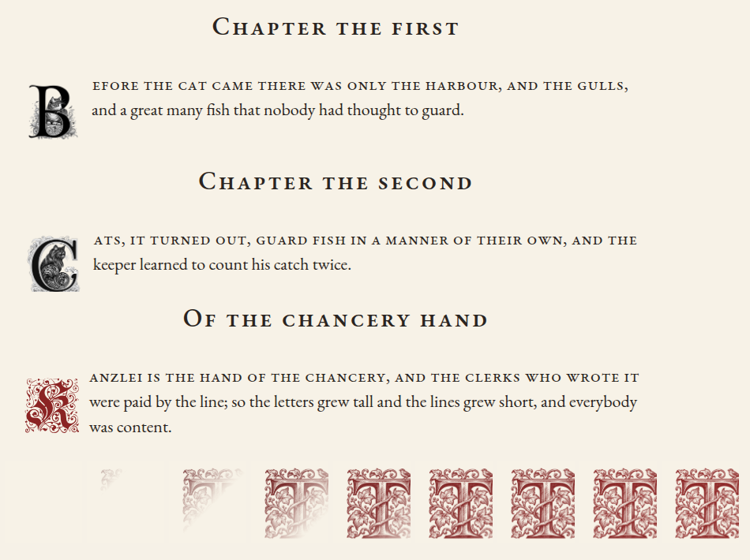
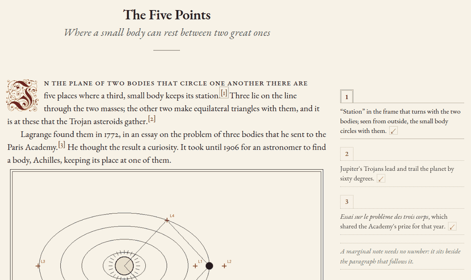
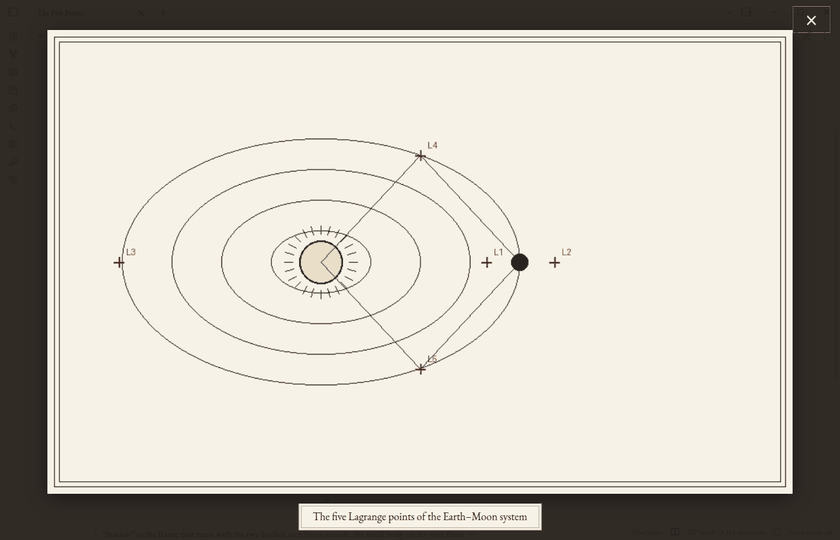

# Scriptorium

A fancy and sophisticated Obsidian configuration for the typographically inclined.


*Lagrange, Scriptorium's writing companion, recorded in Obsidian (Demo provider, so no account is needed to try it).*

Scriptorium gives [Obsidian](https://obsidian.md) book-page typography: bookish serif type, warm paper, centered
small-cap headings, italic subtitles, ornamental drop caps and floral scene breaks, with footnotes set in the margin,
quiet admonitions and a focused view of images, after [gwern.net](https://gwern.net). It is made of:

- **the vault template** (`vault/`): the Typewriter theme, the `manuscript` CSS snippet, writing plugins and a
  Lorem Ipsum sample note;
- **the Scriptorium plugin** (`vault/.obsidian/plugins/scriptorium`), which switches between the regular and the
  Fancy typography, chooses the drop cap, sets footnotes in the margin and images in focus, and (new) keeps the vault
  in step with a folder of your own Google Drive, through rclone;
- **Lagrange** (`vault/.obsidian/plugins/lagrange`), a writing companion: a chat about the open note that also edits
  it when you ask (and commands to revise a selection or proofread a note), each edit struck through and written in by
  a pen;
- **Scriptorium Setup** (`installer/`), a small Windows installer that creates a new vault from the template and, if
  you tick them, installs Obsidian, the fonts and the Longform plugin, then opens the vault in Obsidian with its
  plugins on;
- **script installers** for Windows, macOS and Linux (`installers/`).

Screenshots of both modes: <https://williamliaw.com/scriptorium>

## Fancy mode

Fancy mode starts **off**, with centered small-cap section headings and bordered quotations. Turn it on for quiet
italic quotations and justified openings. Both modes open chapters with a drop cap (an ornamental Yinit initial unless
you choose another) and use the same 1.45 line spacing.

In Obsidian, go to **Settings → Scriptorium → Fancy mode**. You can also click the **feather icon**, click
**Fancy mode: on/off** in the status bar, or run **Scriptorium: Toggle fancy mode** from the command palette. Your
choice is remembered for that vault.

## Drop caps, marginalia, admonitions and image focus

These are set in **Settings → Scriptorium**, and remembered for the vault:

- **Drop cap:** the initial that opens a chapter in Reading view (and while editing, if you turn that on, below):
  **Yinit** (ornamental, the default), **Goudy Initialen** (floriated), a **plain capital** in Cormorant Garamond, or
  **none**. Each is a three-line drop in the accent colour, with the rest of the first line in small capitals; with
  none, the opening paragraph starts with an
  ordinary letter, without small capitals, justified like the rest. Centred and right-aligned text has no drop cap
  unless you ask for one (see [Centred and right-aligned text](#centred-and-right-aligned-text)).
  **One note can have its own:** run **Scriptorium: Choose the drop cap for this note** and move through the list (the
  note shows each as you go); the choice is kept in the note's properties as `dropcap: goudy` (or `yinit`, `plain`,
  `none`, or the name of a set, below), which you can also type yourself. Choosing **The vault's drop cap** removes
  the property. A drop cap that is chosen or changed is inked in: laid down from its top left corner as a pen would lay
  it, pale and wet at first (not when your system asks for reduced motion).
- **Show drop caps while editing (Live Preview)** (new; off by default): with it off, the editor shows the opening
  paragraph as plain text, as it always has, and drop caps are drawn in Reading view and in an exported PDF. Turn it on
  (here, or with **Scriptorium: Toggle drop caps while editing (Live Preview)**; it takes effect at once) and Live
  Preview shows the same drop cap on the same paragraph, in the same face, size and place, with the first line in small
  capitals and broken where Reading view breaks it, so the text does not move when you switch between the two. The
  initial is still the letter you typed: nothing is added to the note, the cursor goes before and after it (click the
  initial to put it there), and selecting, copying, searching and spell-checking see it as any other letter. It stays
  an initial while you write in its paragraph (delete it and the next letter becomes the initial). One exception: where
  a paragraph begins with marks that Live Preview shows only by the cursor (`**Bold** beginning`, `[[a link]] first`),
  its line is plain while the cursor is on it. Source mode stays plain. A paragraph that begins with an HTML tag has
  its drop cap in Reading view only. Lagrange's pen writes round the initial.
- **Marginalia** (on by default): in Reading view, footnotes (`[^1]`, and inline `^[...]` notes) are set in the right
  margin beside their references, as on gwern.net: each note hangs from a small box with its number, between dotted
  rules, with a boxed ↙ back to the reference, and notes whose references are close are stacked so that none covers
  another. Hovering a reference lights its note and the other way round. They need a pane wide enough for the text
  column and a note column (with the 22-pixel text, a window about 1,200 pixels wide with the sidebars closed); where the
  right margin alone is too narrow, the text moves left so that text and notes are centred together. In a narrower pane, or with **Readable line length**
  off, footnotes stay at the foot of the note. A callout of type margin (`> [!margin]`) is a marginal note without a
  number. The command **Scriptorium: Toggle marginalia** turns them on and off.
- **Image focus** (on by default): click an image in a note (Reading view or Live Preview) to see it on its own, on a
  dimmed page, fitted to the window, with its caption below. **←** and **→** step through the note's images ("2 of 5"),
  the mouse wheel zooms and dragging pans, double-click zooms in and out, and **Esc**, a click outside the image or the
  × button returns to the note.

### Sets of drop caps: gwern.net's, your own, and drawn ones



Beside the four above, a drop cap can come from a **set**: images, one or several for a letter, or a font of initials.
Sets appear in the settings' **Drop cap** list and in **Choose the drop cap for this note**, and a note names one in its
properties (`dropcap: Dropcat`). A set of images shows where it has the paragraph's first letter; other paragraphs keep
the vault's drop cap. All of this works in Reading view, light and dark, in **Export to PDF**, and in Live Preview
when **Show drop caps while editing** is on.

Every kind of initial [gwern.net uses](https://gwern.net/dropcap) is here:

| Drop cap | In Scriptorium | `dropcap:` |
| --- | --- | --- |
| Yinit | built in (a font, A to Z) | `yinit` |
| Goudy Initialen | built in (a font, A to Z) | `goudy` |
| Kanzlei Initialen | included as a set (a font, A to Z) | `kanzlei` |
| Deutsche Zierschrift | included as a set (a font, A to Z) | `de-zs` |
| Dropcat (cats) | a selection included (B C G I Q T); the other 62 images on request | `Dropcat` |
| Gene Wolfe (wolves, suns, swords) | a selection included (F T V); the other 24, or 159, on request | `Gene Wolfe` |
| Ninit (machines and flowers; unfinished at gwern.net) | a selection included (A B C); the other 52 on request | `Ninit` |
| Cheshire Initials | not included: its licence forbids publishing it. Named in the list, with where to download it; add your copy as a set | `Cheshire Initials` |

- **More from gwern.net:** **Scriptorium: Download more drop caps from gwern.net** (also a button in the list) shows
  each image set with its size (Dropcat 2.6 MB; Gene Wolfe 0.9 MB, or 35 MB with the images gwern.net keeps only at
  full size; Ninit 25 MB) and fetches the one you choose from gwern.net into the vault's `Scriptorium/Drop caps`
  folder. Nothing is fetched until you press a button; images already there are skipped, so you can stop and go on
  later; without a connection it says so and changes nothing. A paragraph then has one of its letter's images, the same
  one every time the note is drawn (and in the PDF).
- **Your own:** **Scriptorium: Add a set of drop caps** takes a name and your files: one image for each letter you have
  (SVG or PNG, named for its letter: `A.svg`, `b.png`, `initial-C.svg`; `D-dark.png` for a dark-theme version), or a
  font of initials (`.ttf`, `.otf`, `.woff`, `.woff2`: one file, or one for each letter). Each file is checked (an SVG's
  scripts, links and outside references are taken out; a file that is not what its name says is left out) and the set
  is kept in the vault, in `Scriptorium/Drop caps/<name>/`, where you can also put files yourself. Tick **The images
  are of one colour** and they are drawn in the page's accent colour, in the light and the dark theme: ink on white
  paper is made into ink alone (a `set.json` with `{"mono": true}` says the same for a folder you make by hand; for a
  font, `{"size": 4.2, "margin": "0.1em 0.1em -0.12em 0"}` sets its size and place).
- **Drawn by Lagrange:** **Lagrange: Draw a drop cap (or change one)** asks for a letter, a description ("a woodcut
  initial with oak leaves") and a set, has your provider draw it, keeps it in that set, makes it the note's drop cap and
  inks it in. With **your ChatGPT subscription** it is painted by Codex's image tool (about a minute); with an **OpenAI
  API key** by OpenAI's image model (`gpt-image-2.5-sunburst` unless you name another; OpenAI charges for each image;
  this route is experimental: its requests follow OpenAI's published API and are tested against a stand-in, but have
  not been tried against the live service). Claude has no image model, so with **your Claude subscription**, an
  Anthropic API key or a local server the model writes the initial as a line drawing (SVG), which is plainer; the Demo
  has one drawing of its own. Tick **Change the one this set has** to alter an existing initial ("add a small owl"): a
  painted one goes back to the image model, a line drawing back to the language model, and the earlier one is kept in
  the set's `earlier` folder. Image connectors (Canva's, for one) are not used: through Claude Code, Canva's connector
  hands back only a 200-pixel thumbnail of what it generates.

**Export to PDF** sets the page as Reading view does: the note's title at the top (Scriptorium ticks Obsidian's
**Include file name as title** once; untick it in the export dialogue if you do not want it), the drop caps, a note's
own drop cap included, and the small-capped opening lines.

Callouts (`> [!note]`, `> [!tip]`, `> [!warning]`, `> [!error]` and the others) are set as gwern.net's admonitions, in
the snippet: a tinted slip with a broad band and a printer's mark (☞ for a note, † for danger), darker for the more
urgent kinds, in Reading view and Live Preview, light and dark.

### Live Preview and Reading view: what still differs

Scriptorium sets the page in Reading view and in an exported PDF; the editor (Live Preview) is closer to it than it
was, and with **Show drop caps while editing** on the opening paragraph is the same in both to within a pixel. The
rest of the editor is as it was in 1.3.1. These differences are known and left as they are in this version (measured
at a 22 px text size in a 792 px column):

1. **Paragraphs:** the editor shows the blank line between paragraphs and no indent; Reading view sets no gap and
   indents every paragraph after the first by 1.5 em.
2. **Under a heading:** the opening paragraph stands about 17 px lower under the note's title in the editor (more
   after an epigraph or centred verse); a heading's line is deeper in the editor (63 px against 39 px) and its text
   sits 22 px further right, because the editor centres it with the hidden `## `.
3. **Subtitle (`######`):** the editor draws no short rule under it and sets it 22 px further right; the paragraph
   after it is 27 px higher than in Reading view.
4. **Quotations:** the editor sets the text at the bar and to the full width; Reading view sets it in from the bar and
   keeps the right of the column free, so quotations wrap differently.
5. **Lists:** hanging bullets and justified text in the editor; Reading view indents and does not justify.
6. **Body paragraphs** (all but an opening one with its drop cap shown): the editor keeps a line's trailing space on
   the line, so a line that Reading view just fills can lose its last word, and justified lines space a little
   differently.
7. **Centred and right-aligned text:** the `:::` marker lines show, small and faint, in the editor; Reading view
   hides them and sets a line of space above and below.
8. **Typewriter Mode** (shipped on) pads the top of the editor so that the cursor's line stays in place, so vertical
   positions in the window differ from Reading view by design.
9. **Footnotes in the margin, callouts, image captions and the scene-break ornament under the cursor** are Reading
   view only, as before.
10. **With drop caps shown while editing:** a paragraph that begins with an HTML tag has its drop cap in Reading view
    only; Arrow Down from the initial goes to the line under it, not to the second line; beside a picture initial the
    cursor before and after the hidden letter stands in the same place; and a short opening paragraph is followed by
    the blank line beside the initial, so the next paragraph starts one line lower than in Reading view.

### Marginalia



Write footnotes as usual (`[^1]` in the text and `[^1]: The note.` anywhere below, or an inline `^[note]`), and open
the note in Reading view in a pane wide enough for a margin: each footnote sits beside the line that cites it. Point
at a reference to light up its note; the boxed ↙ in a note goes back to its reference. A callout of type margin
(`> [!margin]`) is a marginal note without a number. **Scriptorium: Toggle marginalia** turns them off and on.

### Image focus



Click any image in a note to see it on its own, fitted to the window, with its caption (`![[image.png|A caption]]`).
The mouse wheel zooms and dragging pans, **←** and **→** go to the note's other images, and **Esc** or a click outside
the image returns to the note.

## Centred and right-aligned text

Put a block of text between two marker lines to centre it, or to set it to the right:

```markdown
::: center
Tyger Tyger, burning bright,
In the forests of the night;

What immortal hand or eye,
Could frame thy fearful symmetry?
:::

::: right
— William Blake
:::
```

Between the markers every line of the note is a line on the page (verse needs no two spaces at a line's end), and a
blank line parts two stanzas. Leave a blank line, or a heading, before the opening marker and after the closing one;
a block that is not closed aligns nothing. The text is aligned in Reading view, in Live Preview (where the two
markers stay, small and faint) and in an exported PDF; Source mode shows it as you typed it. To align a whole note,
give it the property `align: center` or `align: right`.

The markers are the fenced container of Pandoc and markdown-it (`::: {.center}` is read too), so the note stays plain
Markdown: Pandoc centres the block as Scriptorium does, and a program that does not know the markers shows them as
two short lines of text. A callout (`> [!center]`) would be the more usual thing in Obsidian, but Live Preview draws
a callout as one block of its own; between the markers the text stays ordinary lines of the editor, which you edit
in place and which Lagrange's pen can write on.

**Commands** (they can be given hotkeys in **Settings → Hotkeys**):

- **Scriptorium: Centre selection** and **Scriptorium: Right-align selection** put the paragraphs the selection
  touches between markers (without a selection, the paragraph the cursor is in), or change the alignment of a block
  that has them already.
- **Scriptorium: Remove alignment** takes the markers out again and leaves the note exactly as it was.

**Drop caps.** Centred and right-aligned text has no drop cap and no small-capped first line, whichever drop cap the
vault or the note uses, in Reading view and in PDF. It does not use up the chapter opening either: under a heading
(or at the top of a note) aligned blocks are passed over, and the first paragraph after them that is not aligned has
the drop cap. A chapter can open with an epigraph in verse and the name under it, and still begin with its initial.
(As before, one quotation may stand between the heading and that paragraph too.)

If you do want a drop cap on aligned text, ask for it:

- for one block, write `::: center dropcap` (or `::: right dropcap`), or run **Scriptorium: Use a drop cap on this
  aligned paragraph** with the cursor in the block; **Scriptorium: Remove the drop cap from this aligned paragraph**
  takes it off again;
- for a whole note, tick **Also on centred and right-aligned text** in **Scriptorium: Choose the drop cap for this
  note**, which writes `dropcap-aligned: true` in the note's properties.

Such a block is then a paragraph like any other: it has the drop cap when it is the first paragraph under a heading,
and the paragraph after it has none. On aligned text the drop cap is a standing initial: it stands on the first
line, at that line's start, so that the initial and the line are centred, or set to the right, together.

Lagrange knows the markers: it centres verse that it writes or quotes, sets a signature to the right when you ask,
and does not ask for a drop cap there unless you do. Its pen writes each centred or right-aligned line where the
note sets it.

## Writing conventions

- The filename supplies the title.
- `###### Subtitle` creates a centered italic subtitle.
- `## Chapter heading` creates a centered small-cap chapter heading; `### Section heading` a smaller one.
- `> Quotation` creates an italic quotation.
- `::: center` and `:::` on lines of their own, around some lines, centre them; `::: right` sets them to the right.
  `align: center` in a note's properties centres the whole note.
- `---` creates an ornamental scene break.
- `dropcap: goudy` (or `yinit`, `plain`, `none`, or a set: `kanzlei`, `de-zs`, `Dropcat`, `Gene Wolfe`, `Ninit`, or one
  of your own) in a note's properties gives that note its own drop cap; `dropcap-aligned: true` lets its centred and
  right-aligned text have one (as `::: center dropcap` does for one block).
- `[^1]` with `[^1]: The note.` creates a footnote, set in the margin in Reading view when there is room.
- `> [!margin]` followed by `> Text` creates an unnumbered marginal note beside the paragraph that follows it.
- `> [!note]`, `> [!tip]`, `> [!warning]`, `> [!danger]` and the other callouts create admonitions.
- `![[image.png|A caption]]` (or ``) gives an image the caption shown when it is in
  focus.
- Images are centred. Put `left`, `right` or `center` before the size to place one: `![[image.png|left|300]]`,
  `![[image.png|right|240]]`, `![[image.png|center]]`. Left and right images float in Reading view.

## Lagrange

Lagrange talks with you about the note you have open and edits it when you ask. Click the **pen-nib icon** (or run
**Lagrange: Open**) for the chat in the right sidebar and type: a question gets an answer, and a request for a change
("fix the grammar", "tighten the second paragraph", "add the equation for kinetic energy") is carried out in the note.
Each edit is struck through and written in by a pen, in handwriting, with a thin trail of ink behind the nib. The
pen writes where the new text stands in the note: its first stroke is where the first letter will be, and its lines
are the note's lines (centred or right-aligned text is written line for line where the note sets it). A long edit is written for three lines (**Settings → Lagrange → Lines the pen writes**) and
the rest is set down at once. An equation is drawn symbol by symbol where the note typesets it, wherever in the edit
it comes, and code (a fenced block, or a code span) is typed on a small typewriter that takes the pen's place. The
edits are then listed in the chat with their reasons.

**Several pens.** When a request has edits that stand well apart on the page, they are written at the same time,
each by a pen of its own: the pens come in one after another, a moment apart, each with its own trail of ink, and
each leaves when its work is done. That happens only where it can be watched without the pens getting in each
other's way: the edits must be in view together (the note is scrolled once to bring them there, if they fit on one
screen), in different paragraphs, and with about three lines of the page clear between them. Edits that are closer
than that wait for the pen that is already there and are written one after another, as before, and so is
everything in a text column narrower than 440 px or in a pane too short for two pens. There are three pens at most
(**Settings → Lagrange → Pens at most**, two to four, and never more than one for about every 210 px of the
editor's height); **Several pens at once** turns it off, and then one pen writes every edit in turn. The note comes
out the same either way, and it is still one undo step; it only takes less time.

**While the pen writes.** The handwriting is on the page itself: scroll the note, resize the pane or zoom, and it
stays on its words. When the pen has finished, the note is where you were looking; nothing scrolls. If you click in
the note, or press a key that would change it, the pen stops at once (every pen, if several are writing): the rest
of the edits are set down together (the note is exactly as it would have been, and it is still one undo step), and
then your click or key takes effect.
If you would rather write alongside it, turn on **Settings → Lagrange → Let me edit while the pen writes**: your
typing goes in as you type, the pen carries on, and an edit whose words you have changed in the meantime is skipped
and listed as such in the chat. **Esc** stops the pen either way (edits not yet written are not made). The chat keeps
to its newest line while Lagrange thinks and writes, unless you scroll up.

**Undo and redo.** One **Undo** in the editor takes back all the edits of a request. The two arrows at the head of the
chat do the same for Lagrange's edits only: **Undo** takes back its latest run of edits and **Redo** makes it again,
run by run, and each run in the chat has its own **Undo Lagrange's edits** button. If you have typed in the note
since, your typing is kept and Lagrange says so.

**Rewind.** Each message you send has a small clock at its right (**Rewind to here**). It takes the conversation back
to just before that message, for the model as well, puts the note back as it was when you sent it, and puts the
message back in the box for you to change. If the note has changes of your own since then, Lagrange asks whether to
put the note back or keep it as it is; Undo in the editor brings the later text back either way. Lagrange keeps the
note's text for the last 20 messages; for an older message the clock is grey, and rewinding there leaves the note as
it is. The commands **Lagrange:
Revise selection** and **Lagrange: Proofread note** do the same for a selected passage or for the whole note. To keep
the chat to talk only, turn off **Settings → Lagrange → Edit with the pen from the chat**; the ink trail has a switch
there too, and neither the trail nor the flying pen is shown when your system asks for reduced motion.

**Looking at the page.** Lagrange reads the note's Markdown, and Markdown does not show how the page comes out: where
the drop cap sits, what is centred, what went into the margin, whether an equation or a picture fits its column. When
a question turns on that ("does the chapter open properly?", "is the epigraph centred?"), Lagrange asks to look, and
the chat says **Lagrange looked at the page**, with a small picture of what it was shown; click it to see all of it,
and the words that went with it. It can look at the whole note, at what you have on screen, at one section, at a
passage, or at a range of lines; it can also change the note and then look at the result, to check its own edit. You
can show it the page yourself: run **Lagrange: Show Lagrange the rendered page**, and the page goes with your next
message. The page is the note as Reading view sets it (the vault's theme, snippets and fonts, Scriptorium's drop caps
and marginalia, mathematics, callouts, pictures, at the width of the note's pane), set out of sight in a page of its
own: your note, its view and the editor are not touched, and nothing is written to the vault. The note's properties
stand above the text where the note's own view shows them. A picture that the note takes from the web is asked for
from its own address once more, as Obsidian asks for it to show the note, and is in the page if its server lets a
page read it; if not, a grey box that says so stands in its place, and Lagrange is told. The small arrows that fold
a heading are not in the page: Reading view shows them only under the pointer.

What Lagrange is given is pictures of the part of the note it asked for and nothing else, each at most 1024 by 1536
pixels, at most four to a look and two looks to a message of yours, with the measurements of that part: each block's
kind, alignment, font and size, its lines, its drop cap, its footnotes, its mathematics as you wrote it, and whether
it is too wide for its column. A model that takes no pictures (many local models; **Settings → Lagrange → Pictures of
the page** says which, and lets you say otherwise) is given the measurements alone, and so is every model on a phone
or tablet, where no picture is taken. A look goes to the provider you have chosen, with the conversation, and to no
one else, and only while Lagrange is answering a message you sent; the pictures are sent once and are not kept in the
conversation. With a Claude subscription they go to Claude Code on its standard input, with no tool turned on and
nothing written to disk; with a ChatGPT subscription Codex takes pictures only as files, so they are written to a
folder of their own in your temporary folder, which only you can read, and deleted when Codex has answered. To keep
Lagrange from ever rendering or capturing the page, turn off **Settings → Lagrange → Let Lagrange look at the
rendered page**.

**Diagrams.** Ask for a figure and Lagrange writes one into the note, and the pen draws it: a technical or
mathematical figure (a graph, a construction, a circuit, a commutative diagram, a plot) as a `tikz` block, which the
[TikZJax](https://github.com/artisticat1/obsidian-tikzjax) plugin sets, and a free-form sketch as an
[Excalidraw](https://github.com/zsviczian/obsidian-excalidraw-plugin) drawing, a file next to the note that the note
embeds. In Live Preview the figure is not typed out: it is kept unseen until the pen comes to it, then drawn line by
line in its own order, its labels last; a key or a click shows it whole at once. In Source mode the pen writes the
source. Both plugins are separate from Scriptorium and are installed with it (see
[The diagram plugins](#the-diagram-plugins)); where one is off, Lagrange is told so, does not write that kind of
figure, and says why in the chat. In demo mode, with TikZJax on, *draw a diagram* shows the pen at it without a model.

What TikZJax takes was tried construct by construct in Obsidian 1.15 with TikZJax 0.5.2, and Lagrange is told the
same: a block is a whole document body (`\usepackage` lines, one `\usetikzlibrary{…}` line, `\begin{document}`, the
picture, `\end{document}`), with no `\documentclass`; plain TikZ, `\foreach` included, needs no library, but
`positioning`, `calc`, `arrows.meta`, `shapes.geometric`, `matrix` and the other libraries must each be named;
`\text` needs `amsmath` and `\mathbb` needs `amssymb`; the packages there are tikz-cd, circuitikz, pgfplots, chemfig,
tikz-3dplot and the AMS ones; a character outside ASCII in a label is an error. TikZJax says nothing when a figure
has an error (it leaves a broken-picture mark), so Lagrange watches for it: the pen does not wait for a figure that
has failed, and the chat says that the figure in the note could not be drawn, or is still not drawn after 30 seconds
(TikZJax sets one figure at a time, and a figure of a thousand shapes takes half a minute).

**What the chat shows.** Replies, and your own messages, are set as Obsidian sets a note: code with its colours and a
copy button, inline and displayed mathematics, Mermaid diagrams, a `tikz` figure where TikZJax is on and an Excalidraw
embed where Excalidraw is on (without the plugin, the source in a code block and a line that says why), pictures and
video of the vault. A `tikz` figure that TikZJax cannot draw (an error in its TikZ), or has not drawn after 30
seconds, gives way to its source under a line that says which. (A figure in a message is put into the chat in one
step, already whole: TikZJax 0.5.2 leaves a figure on its spinner for ever when it is rendered into a panel that is
already on the page, although it has compiled it.) In demo mode, ask Lagrange to *explain* something to see a reply
with mathematics, code and a figure. While a reply arrives, each finished block is set once and what is still being written stays plain
text until it closes. The chat only shows: it runs no code a reply holds (a block that another plugin would act on,
such as a Dataview query, is shown as its source), and it fetches nothing from the web because a reply says so (a
picture at a web address becomes a link).

**Attaching pictures, video and files.** Paste a copied picture, video or file into the box, drop it on the panel
(from your system, or a file of the vault from Obsidian's file explorer), or pick it with the paperclip. Each shows as
a chip you can take off before sending, and in the message once sent (pictures and video as they are, files as chips).
Up to eight to a message; a picture up to 20 MB, a video up to 100 MB, a PDF up to 20 MB, a text file up to 5 MB.
What goes to the model: a picture as a picture, scaled to 1568 pixels on its longer side; a video as up to six frames
taken from it, without its sound, because none of the providers takes video; a PDF as a document with an Anthropic or
OpenAI API key, and as the text taken from it otherwise; Markdown, text, code, CSV and JSON as text, the first 60,000
characters of a longer file. Whatever does not go as it is, the chat says so under your message, and a file Lagrange
cannot read is refused with the reason. A model that takes no pictures is told what was attached in words. The
attachments are kept in memory with the conversation and are gone when you clear it or close Obsidian: nothing is
written into the vault, and a file of the vault is read when you send the message, not before. The last four messages
with attachments keep their pictures and documents for follow-up questions; earlier ones stay as words.

Choose who writes the replies in **Settings → Lagrange**. The default is **your Claude subscription**, through Claude
Code (install it, run `claude` once in a terminal and sign in; no API key). The others are Anthropic's Claude with an
API key, your ChatGPT subscription through Codex, OpenAI with an API key, an OpenAI-compatible server such as a local
Ollama, and **Demo (offline)**, which gives canned replies and edits so you can try it without an account. The two
subscriptions work in Obsidian on a computer only; on a phone or tablet Lagrange says so and asks you to choose an API
key provider or the Demo. API keys are kept, as other Obsidian AI plugins keep theirs, in plain text in the vault's
`.obsidian/plugins/lagrange/data.json`.

The **model and the reasoning effort** are at the foot of the chat: click the model's name to choose another model of
the same provider (or type one) and an effort of low, medium or high. Effort is sent only to models that take one
(current Claude models, Claude Code, Codex and OpenAI's reasoning models); for the others the choice is greyed out.

In Obsidian's light theme the panel uses the paper, ink and oxblood of [williamliaw.com](https://williamliaw.com); in
the dark theme it follows the vault's theme.

## Install

See <https://williamliaw.com/scriptorium> for the downloads and instructions.

- **Windows:** download `Scriptorium-Setup.exe` from the
  [latest release](https://github.com/william590y/scriptorium/releases/latest), open it, choose the vault folder and
  click **Install**. It creates a new vault folder (or fills an empty one; a folder that already has files in it is
  never changed by Install: see [Setting up a vault you already have](#setting-up-a-vault-you-already-have))
  and, if you tick them, installs Obsidian, EB Garamond and Cormorant Garamond for the current user, and downloads the
  Longform plugin and the two plugins Lagrange draws diagrams with, TikZJax and Excalidraw (see
  [The diagram plugins](#the-diagram-plugins)). No administrator rights are needed. With **Open the vault in Obsidian and turn on its plugins**
  ticked (the default), it then opens the new vault in Obsidian with its community plugins on, so Obsidian does not ask
  whether to trust the vault's author (see [Opening the vault](#opening-the-vault-with-its-plugins-on)). If Obsidian
  is open at that point, Setup asks you to close it and choose **Retry**, or **Cancel** to skip this.
- **Updating (Windows):** open a newer `Scriptorium-Setup.exe` and choose your vault folder (by default
  `Documents\Scriptorium`). When the folder is a Scriptorium vault, the button reads **Update** and the window says which
  version is in it. Update replaces Scriptorium's own files with the new ones: the `manuscript` snippet, the code of the
  Scriptorium, Lagrange, Manuscriptum and Typewriter Mode plugins (and Longform's, if ticked), the Typewriter theme and the vault's
  `README.md`. It keeps everything of yours: your notes, the plugins' settings (`data.json`, such as Fancy mode),
  Obsidian's settings and workspace, and the Lorem Ipsum note; files of the configuration that are missing are added
  back, and nothing is deleted. It turns the `manuscript` snippet and Scriptorium's community plugins back on if they
  were off, leaving your own snippets and plugins as they are. With its box ticked, it adds TikZJax and Excalidraw if
  the vault does not have them (see [The diagram plugins](#the-diagram-plugins)). Every file of Scriptorium's it replaces is first copied to
  `.obsidian\scriptorium-backup-<date>-<time>\`, and if anything fails half-way the vault is put back as it was.
  Restart Obsidian (or reload the vault) afterwards. (An updated vault is one Obsidian already knows, so **Open
  Obsidian when done** only starts Obsidian.)
- **A vault you already have:** see [Setting up a vault you already have](#setting-up-a-vault-you-already-have).
- **Script installers:** `installers/Install-Scriptorium-Windows.cmd`, `Install-Scriptorium-macOS.command` and
  `Install-Scriptorium-Linux.sh` do the same from a terminal; they download the configuration from
  williamliaw.com, pinned by SHA-256. They always open the new vault in Obsidian with its plugins on, as Setup does,
  and say what they did; if Obsidian is open they say so and leave the vault for **Open folder as vault**. On Linux
  this works with the AppImage (which the script installs if it finds no Obsidian) and with an Obsidian on `PATH` that
  has its `obsidian-cli` next to it (the `.deb`); a Snap or Flatpak Obsidian keeps its vault list elsewhere, so the
  script only opens Obsidian's vault switcher. The Linux script needs `python3` and `pgrep` for this. All three add
  [the diagram plugins](#the-diagram-plugins) to the new vault.
- **Manual:** extract `Scriptorium.zip` from the latest release, open the folder as a vault in Obsidian, install
  [EB Garamond](https://fonts.google.com/specimen/EB+Garamond) and
  [Cormorant Garamond](https://fonts.google.com/specimen/Cormorant+Garamond), then open **Lorem Ipsum** in Reading
  view. Enable community plugins to use the Fancy mode switch. Longform is enabled in the configuration but not
  included; install it from **Settings → Community plugins**. TikZJax and Excalidraw, which Lagrange draws diagrams
  with, are not in the zip either: install them from the same place.

### The diagram plugins

Lagrange draws technical figures with the [TikZJax](https://github.com/artisticat1/obsidian-tikzjax) plugin and
free-form sketches with the [Excalidraw](https://github.com/zsviczian/obsidian-excalidraw-plugin) plugin. Neither is
part of Scriptorium, and their code is not in this repository, in `Scriptorium.zip` or in `Scriptorium-Setup.exe`.
Instead, every way of installing, updating or setting up a vault downloads them at that moment from each plugin's own
GitHub release, into `.obsidian/plugins/obsidian-tikzjax` and `.obsidian/plugins/obsidian-excalidraw-plugin`, and
turns on the ones it installs: Scriptorium Setup (a new vault, **Update** and **Set up**, while **Download
the TikZJax and Excalidraw plugins** is ticked), the three script installers, `Setup-Scriptorium-Vault.py`
(`--no-diagram-plugins` leaves them out), and **Scriptorium: Set up another vault** / **Set up this vault** in Obsidian.

- The release of each is pinned, and each file (`main.js`, `manifest.json`, `styles.css`) must have the pinned SHA-256;
  a file that does not match is not installed.
- A copy the vault already has is left exactly as it is if it is the pinned version or a newer one; an older copy is
  replaced by the pinned one. A plugin's settings (`data.json`) are never touched, and nothing is deleted.
- Only a plugin that is installed new is turned on. One the vault already had and you turned off (it is in
  `.obsidian/plugins` but not in `community-plugins.json`) stays off, also when its older files are replaced.
- Excalidraw opens a "Welcome to Excalidraw" window the first time it runs. So that a new vault does not open on it,
  Excalidraw is installed with one setting, `{"previousRelease": "<its version>"}`, which is what closing that window
  writes; Excalidraw fills in all its other settings with its defaults when it loads, and still shows its release
  notes after a later update (its **Display Release Notes after update** switch is left on). This file is written
  only with a new install and only where Excalidraw has no `data.json`; one that is there is never changed.
- If a plugin cannot be downloaded (no connection, GitHub not answering, a file that does not match), Scriptorium is
  installed all the same; the installer names the plugin that is missing. To add it by hand: in Obsidian, **Settings →
  Community plugins → Browse**, search for its name, **Install**, then **Enable**.
- Run again, nothing is downloaded twice.

The pinned versions and hashes are in `installers/diagram-plugins.json` (see [Building](#building) for changing them).

### Opening the vault with its plugins on

The first time Obsidian opens a vault that comes with community plugins, it asks whether you trust the vault's author,
and keeps the answer in its own storage, which nothing else should write. Obsidian 1.12 and later has a command line
interface that can give the same answer: `plugins:restrict off` does what the question's
**Trust author and enable plugins** does. The interface works only while `"cli": true` is in Obsidian's `obsidian.json`
(its switch is in **Settings → General → Advanced**), which Obsidian reads when it starts and rewrites while it runs. So
the installers, with Obsidian closed:

1. add the new vault to the vault list in `obsidian.json` (`%APPDATA%\obsidian`, `~/Library/Application
   Support/obsidian` or `~/.config/obsidian`), keeping every other vault and setting, and set `"cli": true`;
2. start Obsidian on the vault;
3. send `vault=<id> plugins:restrict off` until Obsidian answers (it then reloads the vault with the plugins on), and
   wait for the reloaded vault to report `plugins:restrict` = `off`;
4. turn the command line interface off again through Obsidian itself (its own setting switch), unless it was on
   before.

They talk to Obsidian the way its own client does: Setup and the Windows script through the pipe
`\\.\pipe\obsidian-cli-<user>`, the macOS and Linux scripts with the `obsidian-cli` that comes with Obsidian. If
anything fails, the vault is open and Obsidian asks its usual question; the interface is still turned off, through
Obsidian, or in `obsidian.json` once Obsidian has closed (if Obsidian stops answering, a small background process
waits for it to close). An Obsidian older than 1.12 has no command line interface: the vault is opened and Obsidian
asks. To review the plugins later, or to turn them off, use **Settings → Community plugins → Restricted mode**.

### The fonts, face by face

The typography uses four font faces: EB Garamond and Cormorant Garamond, each upright and italic. Every installer
checks them **one face at a time**, and puts right whatever is missing, unregistered or damaged, each time it runs
(installing, updating and setting up a vault alike). This matters because a family with only its *italic* face
installed is still "installed" as far as a list of font families goes, and the system then draws upright text with
the italic: every heading stands in italics. That happened to a writer on Windows (both Cormorant Garamond files
were on disk, only the italic was registered), and versions up to 1.2.4, which asked only "is the family there?",
would never have repaired it.

- **Windows** (Scriptorium Setup and the `.cmd` script): a face is in order only if a Fonts registry value (yours or
  the machine's) names a file that exists and is that face (Scriptorium's file with its pinned SHA-256, or a copy of
  your own), *and* Windows lists the family with that style. The checkbox then reads "… are already installed";
  otherwise it says what is wrong, for example "Repair the fonts (Cormorant Garamond upright is missing)", and is
  ticked. A repair copies the file if needed, registers it under a value name of Scriptorium's own
  (`Scriptorium Cormorant Garamond Regular (TrueType)`, so that another program's install or uninstall of a font of the
  same name cannot take it away), loads it, tells running programs, and looks again. The upright face of a family
  always goes first; if it cannot be installed, the italic is not installed either. If a font file is in use, Setup
  says to close Obsidian and run it again.
- **For support**: `Scriptorium-Setup.exe --check-fonts` prints the state of each face (exit code 0 if all four are
  in order), and `--repair-fonts` puts them right without the window.
- **macOS and Linux scripts**: each file in `~/Library/Fonts`, or in `~/.local/share/fonts/scriptorium` with
  `fc-list` asked for an upright and an italic style of each family; a copy of your own counts. The two faces of a
  family used to be downloaded side by side, so a failed download could leave the italic alone; now the upright
  goes first.
- **In Obsidian**: if a family is on the computer but draws upright text leaning, the Scriptorium plugin says so
  once ("the upright face is missing on this computer … run Scriptorium Setup"), so that the symptom explains itself.

## Setting up a vault you already have

Any vault can be made a Scriptorium vault in one step: a vault you already write in, a new vault Obsidian has just
made, or a folder of notes that has never been opened in Obsidian. There are three ways, and they follow the same
rules:

- **In Obsidian:** in a Scriptorium vault, run **Scriptorium: Set up another vault** from the command palette, choose
  the other vault's folder, read what will change, and click **Set up**. It copies Scriptorium from the vault you are
  in (never your Lagrange API keys or any other setting of yours). **Scriptorium: Set up this vault** does the same to
  the vault you are in, which turns Scriptorium's theme, snippet and plugins back on if they were turned off. Obsidian
  on a computer only.
- **Windows:** open `Scriptorium-Setup.exe` and choose the vault's folder. For a folder that has files in it and is not
  a Scriptorium vault yet, the button reads **Set up**; it asks first, saying how many files it will add and merge.
  (`Scriptorium-Setup.exe --setup-plan <folder>` prints the whole list and changes nothing; `--setup-only <folder>`
  sets it up without a window.)
- **Any system:** `python3 installers/Setup-Scriptorium-Vault.py /path/to/vault` (Python 3.8 or later, nothing else).
  It lists what it will change and asks before doing it; `--dry-run` only lists, `--yes` does not ask. From a checkout
  it takes Scriptorium from `vault/`; alone, it downloads `Scriptorium.zip` from williamliaw.com, pinned by SHA-256.

What setting up does, and does not do:

- It writes only inside the vault's `.obsidian` folder. **No note is touched**, nothing is deleted, and the sample
  note and README of the Scriptorium vault are not brought along.
- Scriptorium's own files are added: the `manuscript` snippet, the Typewriter theme, and the Scriptorium (with its
  sets of drop caps), Lagrange, Manuscriptum and Typewriter Mode plugins. A file of the same name that differs is replaced.
- Your settings are merged, not overwritten. Your community plugins stay on and Scriptorium's are added to the list;
  your snippets stay on and `manuscript` is added; the theme becomes Typewriter; Scriptorium's text size (22) is set
  only if you have not chosen one. A plugin's own settings (`data.json`) are written only if it has none. Your hotkeys,
  workspace, core plugins and every other setting are left as they are.
- Before anything changes, the whole `.obsidian` folder as it was is copied to
  `.obsidian/scriptorium-backup-<date>-<time>/.obsidian`. If anything fails half-way, every file is put back. To undo
  a setup later, copy the files back from that folder.
- [The diagram plugins](#the-diagram-plugins), TikZJax and Excalidraw, are downloaded from their own releases and
  turned on, unless the vault has them already (then they, and their settings, are left as they are).
- Run again, it changes nothing and makes no second backup.

Close the vault in Obsidian first (Obsidian rewrites some of these files while a vault is open), or reload it
afterwards. When you open it, Obsidian asks whether to trust the author of its plugins: choose **Trust author and
enable plugins**. Install the fonts as in **Manual** above if this computer does not have them (Scriptorium Setup
offers to).

## Syncing a vault with Google Drive (new)

Scriptorium can keep a vault and a folder of your own Google Drive the same, in both directions and by itself: write on
one computer, carry on at another. It needs no server of ours. The work is done by
[rclone](https://rclone.org) (MIT licence), a free program made for exactly this, which Scriptorium runs for you: you
sign in to Google in your browser, pick the folder in your Drive by hand, and from then on the two are kept in step
with [`rclone bisync`](https://rclone.org/bisync/).

The sign-in has been tested with Google, and works. If something goes wrong, the window says what happened, the
likely cause and what to do, and **Scriptorium: Copy the Google Drive diagnostic report** gives a summary to paste,
without your sign-in in it.

It runs in Obsidian on a computer (Windows, macOS, Linux). On a phone or tablet the commands say so: rclone cannot run
there.

### Setting it up

1. Run **Scriptorium: Sync this vault with Google Drive** (or **Settings → Scriptorium → Google Drive sync → Set
   up…**).
2. **rclone.** If rclone is already installed, Scriptorium finds it (the `PATH`, Homebrew's and the other usual
   folders, or the path you give in the settings). If not, it offers to download it: the official build of rclone
   1.76.0 for your system, about 30 MB, from `downloads.rclone.org` (or rclone's GitHub release if that cannot be
   reached). The file is checked against the SHA-256 that rclone published for that version, which is written into
   the plugin, before anything is run; a file that differs is deleted. It is unpacked into Scriptorium's own folder,
   outside every vault (see **Where things are kept**).
3. **Sign in.** Click **Sign in with Google**. Your browser opens Google's page; choose the account and allow access.
   The browser ends on a page at `127.0.0.1:53682` that says "Success": that is rclone on your own computer, taking
   Google's answer. Obsidian carries on by itself.
4. **Pick the folder.** A small browser shows the folders of your Drive (My Drive; **Other places…** has "Shared with
   me" and shared drives). Open the folder you want, or make one with **New folder here…**, and click **Use "…"**.
5. **Look at what the first sync will do.** Scriptorium compares the two sides and shows the counts: files only here
   (copied up), files only in Drive (copied down), files that are the same, and files with the same name but different
   contents. For those you choose: **keep both** (the default: Drive's version keeps the name and yours is kept beside
   it as `name.conflict1.md`), keep this computer's, or keep Drive's. The first sync deletes nothing. Click **Start
   syncing**.

From then on the status bar says **Drive: synced 14:02**. Click it to sync at once, to see conflicts and problems, to
choose another folder, or to stop.

**A second computer.** Install Scriptorium there, then either run **Scriptorium: Retrieve a vault from Google Drive**
(sign in, pick the Drive folder, pick a new folder on the computer: the vault is copied down, set up as a Scriptorium
vault, linked to its Drive folder and offered to be opened), or open a vault you already have there and run **Sync this
vault with Google Drive**, picking the same Drive folder. **Set up another vault** has a **Retrieve one from Google
Drive…** button too.

### The sign-in, and a client ID of your own

rclone asks Google for the permission "See, edit, create, and delete all of your Google Drive files" (the scope
`drive`). That is what lets you pick any folder; Scriptorium only ever points rclone at the folder you chose.

Google gives such a permission to an *app*, named by a client ID. There are two:

- **rclone's own**, shared by everyone who uses rclone. It needs no preparation, but rclone's documentation for 1.76
  says that this shared client ID "is being retired and will stop working during 2026", and it is rationed among all
  rclone users. If Google's page says "Access blocked", "deleted_client" or "This app is blocked", this is why.
- **One of your own**, which rclone recommends. It takes about ten minutes, once, and costs nothing. The sign-in
  window lists the steps with links (they are rclone's own,
  [Making your own client_id](https://rclone.org/drive/#making-your-own-client-id)): make a Google Cloud project, turn
  on the Drive API, fill in the consent screen, add the scope ending in `/auth/drive`, publish the app (left in
  "Testing", Google signs you out every seven days), create a client of type **Desktop app**, and paste its client ID
  and secret. Google will say it has not verified the app: it is your own, so choose **Advanced → Go to …**.

The client ID and secret, if you give them, are written into Scriptorium's own rclone config file, not into the vault
and never onto a command line. **Settings → Scriptorium → Google account → Disconnect** removes the sign-in from this
computer (and withdraws it at Google where rclone can).

### What keeps your files safe

- **Nothing is deleted by the first sync**, and it is only run after you have seen what it will do.
- **A file changed on both sides keeps both.** The newer one keeps the name; the older becomes `name.conflict1.md`
  (then `conflict2`, and so on) on both sides. The status window lists these copies until you delete them.
- **A missing side stops the sync instead of emptying the other.** A small file, `.scriptorium-sync`, is kept on both
  sides; a run in which it is missing on either side changes nothing (rclone's `--check-access`). That covers a Drive
  folder that was emptied, moved or replaced, a different Google account, and a vault whose disk is not connected.
  rclone also refuses by itself to sync against a side with no files at all.
- **A limit on deletions.** If more than half of the synced files disappeared on one side since the last sync (the
  share can be changed in the settings), the run stops and asks. **Sync anyway** goes on.
- **What a sync removes or replaces on this computer is kept for thirty days** in Scriptorium's own folder
  (**Replaced files…** opens it). What it removes in Drive goes to Drive's trash, and a replaced file there keeps its
  earlier versions, as Drive does.
- **One run at a time.** A lock file stops a second window or a second run; a run that was cut off (the computer went
  to sleep, Obsidian was closed) is picked up by the next one (`--resilient --recover`).
- **No token in the vault.** See **Where things are kept**.

When does it sync? When Obsidian starts, every five minutes (a setting), about 45 seconds after the last change to a
note, when you ask, and, if something is waiting, it tries once more as Obsidian quits (for a quarter of a minute at
most; whatever is left is synced when Obsidian next starts). A
problem that needs you (signing in again, a safety stop) pauses the timer until you have looked; anything else, such
as being offline, is tried again by itself, more slowly each time.

### What is synced

Your notes and attachments, in the vault's own folders, and by default Obsidian's settings too (`.obsidian`: settings,
plugins, themes, snippets), so that a second computer gets the same setup. **Sync Obsidian's settings, plugins, themes
and snippets** in the settings turns that part off; set it the same way on every computer.

Never synced: the layout of Obsidian's windows (`.obsidian/workspace*`), caches, `.trash`, hidden folders such as
`.git`, `node_modules`, the copies that setting up a vault keeps (`scriptorium-backup-…`), **Lagrange's settings,
which hold API keys**, system litter (`.DS_Store`, `Thumbs.db`), and Google's own documents (Docs, Sheets and Slides
are not files that can be downloaded as they are). Other plugins' settings are synced as they are: if one of them keeps
a key or password in its `data.json`, it goes to your Drive with the rest.

Names: Drive allows characters in a name that Windows does not (`: * ? " < > |`, a trailing full stop). rclone
replaces them with look-alike characters on the way down to a Windows computer and puts them back on the way up, so
such files sync; they look slightly different in Windows' file manager. Drive also allows two files of the same name
in one folder, which no computer does: rclone warns and syncs one of them, so rename one in Drive. And rclone keeps
its record of a sync in a file named after both paths: if the vault's folder and the Drive folder have paths of more
than about 225 characters together, Scriptorium says so and asks for a shorter one.

### Where things are kept

Outside every vault, in one folder per user of the computer:

| System | Folder |
|---|---|
| Windows | `%LOCALAPPDATA%\Scriptorium` |
| macOS | `~/Library/Application Support/Scriptorium` |
| Linux | `$XDG_DATA_HOME/scriptorium`, or `~/.local/share/scriptorium` |

- `rclone.conf`: rclone's config with the sign-in, readable by you alone. It is **Scriptorium's own**: every call to
  rclone names it with `--config`, any `RCLONE_…` variable in your environment is taken away for the call, and your
  own rclone configuration (`~/.config/rclone/rclone.conf`) is never read or changed.
- `rclone/v1.76.0/`: rclone itself, if Scriptorium downloaded it.
- `sync-vaults.json`: which Drive folder goes with which vault on this computer. `sync-device.json`: the path to
  rclone, if you gave one.
- `bisync/`, `filters/`, `locks/`: rclone's record of the last sync of each vault, the list of what is synced, the lock.
- `replaced/<vault>/<date>/`: what syncs removed or replaced on this computer, for thirty days.

In the vault there is only the check file `.scriptorium-sync` and, in the plugin's settings, how often to sync and
what to include. To remove everything: **Disconnect**, then delete that folder.

### When it does not work

Every failure is shown as a sentence, its likely cause and what to do, with the buttons that do it; rclone's own words
are folded away under **Details**. **Copy diagnostic report** (in every such window, in the settings, and as a command)
puts on the clipboard what was tried and how rclone answered: versions, whether you are signed in, the last runs and
their errors. Tokens, secrets and your email are cut out, paths in your home folder start at `~`, and the names of
files are left out where Scriptorium recognises them; read it over before you post it.

The ones you are most likely to meet:

| It says | What it means |
|---|---|
| Google refused the app that asked to sign in | rclone's shared client ID has been retired, or your own is mistyped: use **A client ID of my own**. |
| Google's answer did not arrive in ten minutes | The browser page was closed or blocked. Try again; the window has **Open the sign-in page again**. |
| Another sign-in is already waiting | Something else is using port 53682 (another rclone, a second window). Close it and try again. |
| This computer is not signed in / Google no longer accepts this computer's sign-in | Sign in again; the folder and the files are kept. A client ID left in "Testing" does this every seven days. |
| The file that proves both sides are there is missing | One side was emptied, moved or swapped. Nothing was changed. Look, then **Set up the sync again**. |
| … disappeared since the last sync, which is more than the safety limit | A folder was deleted or renamed. **Sync anyway** if that was you. |
| Google Drive could not be reached / asked rclone to slow down | Offline, or too many requests: it tries again by itself. |

### Coming from the older Google Drive backup

Versions 1.2.0 to 1.2.2 had an experimental backup that reached Drive through Claude Code's Google Drive connector,
and a preview of a direct Google sign-in. Both are gone: they found the vault in Drive by a list of their own, needed a
Claude account or a client ID before anything worked, and failed with messages that came straight from the programs
underneath. The commands keep their places in the palette (and any hotkey you gave them).

- **A backup made through Claude Code** (the folder `Scriptorium/<vault name>` in My Drive) can be carried on: pick
  that folder as the Drive folder. Its list of files (`scriptorium-manifest.json`) and its `_trash` folder are left
  where they are and are not synced; delete them in Drive when you like. Its pictures were stored under a neutral file
  type, which only affects how Drive's web page previews them, not their contents.
- **A backup made with the direct preview** can be seen only by the Google app that made it (it had the permission
  `drive.file`). Download that folder from drive.google.com if you need it, or start afresh with a new folder.
- The old sign-in file (`scriptorium-google-drive.json`, next to where `rclone.conf` is now on macOS, in
  `%APPDATA%\Scriptorium` on Windows, in `~/.config/scriptorium` on Linux) is no longer used and can be deleted.

### How it was tested

- `plugins-tests/rclone-real.test.js` runs the real rclone 1.76.0 with a second folder standing in for Drive (an
  rclone "alias" remote under the same name): the first sync with each choice, steady syncing, conflicts, deletions,
  the deletion limit and **Sync anyway**, an emptied, missing or swapped side, a run cut off halfway and picked up
  (by a kill, and by Scriptorium's own stop), the lock, the filters and changing them, a 48 MB file, names in several scripts, a path of more than 300
  characters, names that Windows forbids, two computers on one folder, retrieving, and the sign-in as far as rclone's
  listener and the address it sends the browser to. GitHub Actions runs it on Linux, Windows and macOS, after
  downloading rclone with the plugin's own downloader and SHA-256 check.
- `plugins-tests/rclone-sync.test.js` tests, with a pretend rclone (`fake-rclone.js`), where things live on each
  system, how rclone is found and run (without a shell; awkward paths), the config file, the folder browser, the
  commands that are built, every failure message, the timer and the report.
- In a real Obsidian 1.15 on Linux the whole flow was driven by hand against the stand-in: download, sign-in page (with
  the real rclone listening, then cancelled), browsing and making a folder, the first-sync page, syncing after an edit
  and on the timer, a conflict, the safety stops, retrieving into a new folder and opening it.
- The sign-in with the real Google has been run by the author, and works.
- **Not verified:** the windows themselves on Windows and macOS (the engine is tested there, the Obsidian windows
  only on Linux).

To check the sign-in yourself, in three steps: (1) run **Scriptorium: Connect to Google Drive (sign in to Google)**
and finish Google's page; the window should go on to "This computer is signed in to Google Drive". (2) Run **Sync
this vault with Google Drive**, make a new folder in the browser and start the first sync; the folder should appear
at drive.google.com with your notes in it. (3) Change a note, wait a minute, and look at that file in Drive. If any
step fails, run **Copy the Google Drive diagnostic report** and send it.

## Building

Everything is built from this repository; the release files are built by GitHub Actions
(`.github/workflows/build.yml`) on GitHub-hosted runners.

| Output | Command | Needs |
|---|---|---|
| `dist/Scriptorium.zip` | `python3 tools/build_zip.py` | Python 3.9 or later |
| `dist/Scriptorium-Setup.exe` | `tools/build_exe.sh` (rebuilds the zip first) | [Mono](https://www.mono-project.com) (`csc` on `PATH`, or `MONO=<prefix>`) |
| `installer/fonts/*.ttf` (committed) | `python3 tools/build_fonts.py` | Python 3.9 or later, [fontTools](https://github.com/fonttools/fonttools) |
| Lagrange's unit tests | `node --test plugins-tests/lagrange.test.js` | Node.js 18 or later |
| Setting up a vault you already have | `python3 tools/test_setup_vault.py [dist/Scriptorium-Setup.exe]` | Python 3.9 or later; Node.js for the plugin's command; Mono for the exe off Windows |
| The diagram plugins, by every installer | `python3 tools/test_diagram_plugins.py [dist/Scriptorium-Setup.exe]` | Python 3.9 or later; bash for the macOS and Linux scripts; PowerShell for the Windows script; Mono for the exe off Windows |
| The diagram plugins' pins | `python3 tools/pin_plugins.py` (`--online` also checks the files on GitHub) | Python 3.9 or later |

The Scriptorium plugin's layout and parsing helpers (sidenote placement and stacking, footnote definitions, image
captions) are tested with `node --test plugins-tests/scriptorium.test.js` (Node 18 or later); CI runs it on Linux.

The zip is deterministic: sorted entries, one fixed timestamp (or `SOURCE_DATE_EPOCH`) and fixed permissions, so the
same `vault/` gives the same bytes. CI rebuilds it on Linux and checks that it matches the Windows build. The installer
embeds the zip as the resource `Scriptorium.zip`. On Windows, CI compiles it with the Roslyn `csc.exe` from Visual
Studio Build Tools against the .NET Framework 4.8 reference assemblies, with the same switches as `build_exe.sh`.

The installer draws its own window in Scriptorium's style, ink on paper, set in EB Garamond and Cormorant Garamond. It
embeds the four faces it uses (`installer/fonts/`): static instances of the same pinned Google Fonts files it downloads,
subset to Latin and given private names, made by `tools/build_fonts.py`. They only draw the window; they are never
installed.

To check a build without installing anything:

```sh
mono dist/Scriptorium-Setup.exe --extract-only /tmp/scriptorium-check/vault   # on Windows, run the exe directly
```

This unpacks the embedded vault into a new (or empty) folder and exits; it downloads nothing. Likewise,
`Scriptorium-Setup.exe --update-only <vault>` updates an existing Scriptorium vault in place, as **Update** does, but
without Longform and without downloading anything. `python3 tools/test_update.py dist/Scriptorium-Setup.exe` tests it
(edited notes, settings and snippets kept, Scriptorium's files replaced and backed up, settings merged, unreadable JSON
left alone, other folders refused, a failure half-way undone); CI runs it on Windows, and it runs under Mono elsewhere
(`MONO=<prefix>`).

`Scriptorium-Setup.exe --register-only <obsidian.json> <vault> [--cli]` adds a vault to the vault list in the given
`obsidian.json`, as opening the vault does. `python3 tools/test_auto_open.py dist/Scriptorium-Setup.exe` runs the same
cases (no file yet, other vaults and settings kept, a vault already listed, `"cli"` on, off or missing and put back,
unreadable files left alone) against Setup and against each script's own editor of the file (the Windows script's C#
class, the Linux script's Python and the macOS script's JavaScript, the last with Node); CI runs it on Windows, and the
scripts' part (`--scripts-only`) on Linux. `Scriptorium-Setup.exe --auto-open-only <vault> <Obsidian.exe>` opens a
vault in Obsidian as **Install** does and prints each command and Obsidian's answer.

`Scriptorium-Setup.exe --install-only <folder>` makes a new vault as **Install** does and adds the diagram plugins,
without Obsidian, fonts or Longform; `--update-only` and `--setup-only` add them too. `--plugin-pins <file>` (one line
per file: `id|name|version|file|SHA-256|address`) stands in for the pinned releases, and
`SCRIPTORIUM_NO_DIAGRAM_PLUGINS=1` leaves the plugins out. `python3 tools/test_diagram_plugins.py
dist/Scriptorium-Setup.exe` uses these to test a new vault, an update and a set-up against releases served from the
same computer: a vault without the plugins, one with a newer and an older copy and settings of their own, a file that
is missing, a file with the wrong SHA-256, and no connection. It runs the Windows script's PowerShell the same way
(on Windows), the macOS and Linux scripts with a stand-in `curl`, and `Setup-Scriptorium-Vault.py`.

**Before a release: the pins of the diagram plugins.** `installers/diagram-plugins.json` is the one place the versions
and SHA-256 hashes of TikZJax and Excalidraw are changed. Each installer is a single file that has to work alone, so
each carries a copy; `python3 tools/pin_plugins.py` (CI runs it) fails if a copy differs from the file. For every
release of Scriptorium: run `python3 tools/pin_plugins.py --online`, which downloads the pinned files and checks them,
and says whether a newer release exists. To move to one, run `python3 tools/pin_plugins.py --bump <id> <version>` (it
downloads that release, and rewrites the file and all the copies), read the plugin's licence again, update the versions
in this README and in `THIRD_PARTY.md`, check in Obsidian that Lagrange still draws with it, and run the tests. The
site's copies of the script installers get the new pins with the release, like the SHA-256 of `Scriptorium.zip`.

To look at the window without installing anything, run `Scriptorium-Setup.exe --render screenshots` on Windows: it
draws the window offscreen in each of its states (ready, downloading, installing, done, failed, updating a vault, and the
frames of a whole install) and saves them as PNGs. CI does this on every build and uploads them as the `screenshots` artifact.

## Repository layout

```
vault/        the vault template (the Scriptorium and Lagrange plugins and the snippet live here)
plugins-tests/ unit tests for Lagrange's plain functions (not packaged)
installer/    Scriptorium Setup: ScriptoriumSetup.cs, app.manifest, scriptorium.ico, and fonts/ (the window's type)
installers/   the script installers, and Setup-Scriptorium-Vault.py (sets up a vault you already have)
tools/        build_zip.py, build_exe.sh, build_fonts.py, test_update.py, test_auto_open.py, test_setup_vault.py, test_fonts.py
plugins-tests/ tests for the Scriptorium plugin's layout and parsing (node --test plugins-tests/scriptorium.test.js)
              and for its Google Drive sync: rclone-sync.test.js (with a pretend rclone, fake-rclone.js) and
              rclone-real.test.js (with the real rclone and a second folder standing in for Drive)
licenses/     licenses of embedded fonts
docs/         the pictures in this README (recorded and captured in Obsidian)
```

## Third-party components

| Component | Where | Author | License |
|---|---|---|---|
| [Typewriter theme](https://github.com/crashmoney/obsidian-typewriter) 2.3.4 | `vault/.obsidian/themes/Typewriter` | crashmoney | GPL-3.0 |
| [Manuscriptum](https://github.com/sgranade/manuscriptum) 1.0.2 | `vault/.obsidian/plugins/manuscriptum` | Stephen Granade | MIT |
| [Typewriter Mode](https://github.com/davisriedel/obsidian-typewriter-mode) 1.6.1 | `vault/.obsidian/plugins/typewriter-mode` | Davis Riedel | MIT |
| Yinit initials (from [yinit-otf](https://ctan.org/pkg/yinit-otf)) | embedded in `vault/.obsidian/snippets/manuscript.css` | Yannis Haralambous | Public domain |
| Goudy Initialen (from [initials](https://ctan.org/pkg/initials)) | embedded in `vault/.obsidian/snippets/manuscript.css` | after F. W. Goudy; Dieter Steffmann | LaTeX Project Public License |
| EB Garamond and Cormorant Garamond subsets, for the installer's window | `installer/fonts` | The EB Garamond Project Authors; the Cormorant Project Authors | SIL OFL 1.1 |

Each license file sits next to its component. These are not part of this repository and not included in the
installer; they are downloaded from their official sources only when you tick them (the script installers, which have
no boxes, download Obsidian, the fonts and the two diagram plugins):

| Component | Source | License |
|---|---|---|
| [Longform](https://github.com/kevboh/longform) 2.1.0 | its official GitHub release | its own license (see its repository) |
| [TikZJax](https://github.com/artisticat1/obsidian-tikzjax) 0.5.2 | its own GitHub release, into the vault's `.obsidian/plugins` | MIT |
| [Excalidraw](https://github.com/zsviczian/obsidian-excalidraw-plugin) 2.29.2 | its own GitHub release, into the vault's `.obsidian/plugins` | AGPL-3.0 |
| [Obsidian](https://obsidian.md) 1.15.0 | its official GitHub release | proprietary (free to use) |
| [EB Garamond](https://github.com/google/fonts/tree/main/ofl/ebgaramond), [Cormorant Garamond](https://github.com/google/fonts/tree/main/ofl/cormorantgaramond) | Google Fonts' GitHub repository | SIL Open Font License 1.1 |
| [rclone](https://rclone.org) 1.76.0 | `downloads.rclone.org` (or its GitHub release), by the Scriptorium plugin, when you agree in the Google Drive sync's window | MIT |

See [THIRD_PARTY.md](THIRD_PARTY.md) for details.

## Code signing policy

*Applies once the project's application to SignPath Foundation is approved; until then, releases are unsigned.*

Free code signing provided by [SignPath.io](https://about.signpath.io), certificate by
[SignPath Foundation](https://signpath.org).

Team roles:

- Committers and reviewers: William Liaw ([@william590y](https://github.com/william590y))
- Approvers: William Liaw ([@william590y](https://github.com/william590y))

Only files built by this repository's GitHub Actions workflow from this repository's source are signed.

## Privacy policy

This program will not transfer any information to other networked systems unless specifically requested by the user
or the person installing or operating it.

Scriptorium Setup downloads the following, and only when you tick the matching option in its window:

- Obsidian's official installer, from Obsidian's GitHub releases (`github.com/obsidianmd/obsidian-releases`);
- the EB Garamond and Cormorant Garamond fonts, from Google Fonts' GitHub repository
  (`raw.githubusercontent.com/google/fonts`);
- the Longform plugin's official release, from its GitHub releases (`github.com/kevboh/longform`);
- the TikZJax and Excalidraw plugins' official releases, from their GitHub releases
  (`github.com/artisticat1/obsidian-tikzjax`, `github.com/zsviczian/obsidian-excalidraw-plugin`).

Each download is verified against a SHA-256 hash pinned in the installer. Nothing is uploaded, and there is no
telemetry, analytics or update check. Opening the new vault with its plugins on talks only to Obsidian on the same
computer, through Obsidian's local command line pipe. The Scriptorium plugin makes no network requests, with two
exceptions that you start yourself. **Download more drop caps from gwern.net** fetches the images of the set you choose
from `gwern.net`, when you press its button, and sends nothing but the request for each image. Its Google Drive sync
(new, and only once you have set it up) runs rclone on your computer, which talks to Google's servers
(`accounts.google.com`, `oauth2.googleapis.com`, `www.googleapis.com`) with your own sign-in and sends the vault's files
to, and fetches them from, the folder of your own Google Drive that you picked; nothing goes anywhere else. If rclone
is not on the computer and you agree, the plugin downloads it from `downloads.rclone.org` (or `github.com/rclone`) and
checks it against a pinned SHA-256 (see **Syncing a vault with Google Drive**).

Lagrange, the writing companion, sends the open note and what you write to it to the provider you choose in its
settings, and only when you send it a message or run one of its commands: your Claude subscription through the Claude
Code program on your computer (the default), Anthropic's API at `api.anthropic.com`, your ChatGPT subscription through
the Codex program, OpenAI's API at `api.openai.com`, or the OpenAI-compatible server whose address you enter. It makes
no other requests, and none in Demo mode. Its handwriting font is inside the plugin; nothing is downloaded. When it
**looks at the page** (see [Lagrange](#lagrange)), pictures of the part of the note it asked for, as rendered, and
their measurements go to that same provider with the conversation, and nowhere else; with the setting **Let Lagrange
look at the rendered page** off, the page is never rendered or captured.
**Draw a drop cap** sends the letter and your description (and, to change one, the present image) to the same
provider: with the OpenAI API, to its Images API at `api.openai.com`; with a ChatGPT subscription, Codex runs in an
empty temporary folder, the only place it may write.

## Uninstalling

Scriptorium Setup does not register itself as an installed program; everything it adds can be removed by hand:

1. **The vault:** delete the vault folder you chose (by default `Documents\Scriptorium`). In Obsidian, remove it from
   the vault list with **Open another vault → … → Remove from list**. (To keep the vault but drop the copies an update
   made, delete its `.obsidian\scriptorium-backup-…` folders.)
2. **The fonts:** open **Settings → Personalization → Fonts**, select EB Garamond and Cormorant Garamond and choose
   **Uninstall**. They were installed for the current user only, in `%LOCALAPPDATA%\Microsoft\Windows\Fonts`.
3. **Obsidian:** uninstall it in **Windows Settings → Apps → Installed apps**.

## License

Copyright (C) 2026 William Liaw

This program is free software: you can redistribute it and/or modify it under the terms of the GNU General Public
License as published by the Free Software Foundation, either version 3 of the License, or (at your option) any later
version.

This program is distributed in the hope that it will be useful, but WITHOUT ANY WARRANTY; without even the implied
warranty of MERCHANTABILITY or FITNESS FOR A PARTICULAR PURPOSE. See the GNU General Public License for more details.

You should have received a copy of the GNU General Public License along with this program. If not, see
<https://www.gnu.org/licenses/>. The full text is in [LICENSE](LICENSE).

Third-party components keep their own licenses (above).
